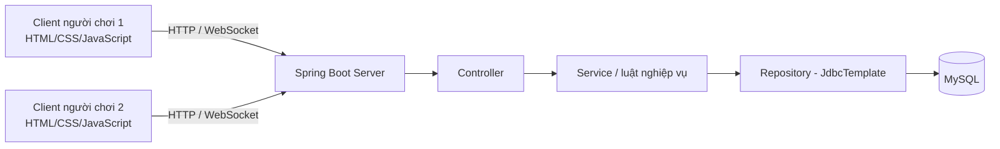
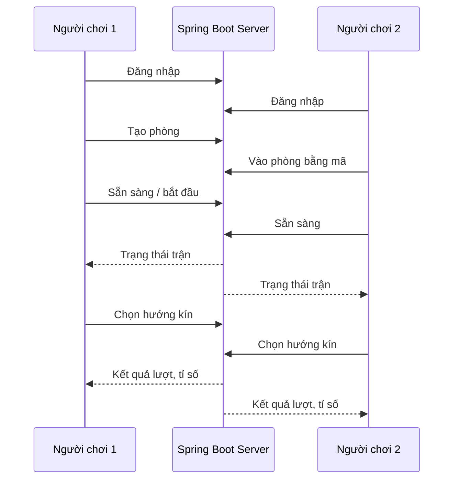

# BÁO CÁO TIỂU LUẬN MÔN LẬP TRÌNH MẠNG

## Đề tài: Game đá luân lưu trực tuyến cho 2 người

| Thông tin | Nội dung |
| --- | --- |
| Mô hình | Client/server, web application |
| Backend | Java 21, Spring Boot 4.1.2 |
| Client | HTML, CSS, JavaScript thuần |
| Dữ liệu | MySQL 8, SQL tự viết qua `JdbcTemplate` |
| Kỹ thuật mạng | HTTP hiện có; WebSocket là phần thiết kế cho giai đoạn tiếp theo |
| Trạng thái báo cáo | Cập nhật ngày 11/11/2026; đã hoàn thành Bước 1 và Bước 2 ở mức mã nguồn |

> Điền thông tin nhóm trước khi nộp: lớp, giảng viên, thành viên, mã sinh viên và phân công cụ thể của từng thành viên.

---

## Tóm tắt

Đề tài xây dựng game đá luân lưu trực tuyến dành cho hai người chơi. Hai client kết nối đến một server Spring Boot. Server chịu trách nhiệm xác thực tài khoản, quản lý phòng, giữ trạng thái trận, chấm kết quả và lưu lịch sử; client chỉ hiển thị giao diện và gửi yêu cầu của người chơi. Cách tổ chức này phù hợp mô hình client/server và tránh việc một client tự thay đổi tỉ số hoặc hướng sút.

Phiên bản hiện tại đã có khung Spring Boot, cấu hình MySQL, thiết kế cơ sở dữ liệu 9 bảng, trang đăng ký/đăng nhập/đăng xuất, xác thực bằng BCrypt, phiên `HttpSession` và các truy vấn SQL dùng `JdbcTemplate`. Phần phòng chơi, WebSocket, luật đá luân lưu, lịch sử và thống kê đã được thiết kế nhưng **chưa cài đặt**, vì vậy không được xem là chức năng đã hoàn thành.

---

# 1. Đặt vấn đề

## 1.1. Lý do chọn đề tài

Game đá luân lưu có luật đơn giản nhưng cần đồng bộ trạng thái giữa hai người chơi: ai đang sút, ai đang bắt, thời gian còn lại, hướng chọn và tỉ số. Đây là bài toán phù hợp để áp dụng kiến thức lập trình mạng theo mô hình client/server, giao thức trao đổi dữ liệu thời gian thực và cơ sở dữ liệu.

Đề tài giúp nhóm thực hành các nội dung sau:

- Xây dựng ứng dụng web Java theo mô hình MVC.
- Tổ chức client/server; server là nơi quyết định dữ liệu đáng tin cậy.
- Dùng HTTP cho tài khoản và WebSocket cho trạng thái phòng/trận theo thời gian thực.
- Lưu dữ liệu bằng MySQL với SQL viết tay qua `JdbcTemplate`.
- Bảo vệ mật khẩu bằng BCrypt, dùng session để nhận diện người chơi.

## 1.2. Phát biểu bài toán

Hệ thống cho phép một người dùng đăng ký và đăng nhập, tạo hoặc tham gia một phòng có tối đa hai người. Khi hai người sẵn sàng, chủ phòng bắt đầu trận. Trong mỗi lượt, người sút và thủ môn cùng chọn một trong ba hướng `LEFT`, `CENTER`, `RIGHT`. Server chỉ công bố lựa chọn khi lượt đã được chấm để bảo đảm tính công bằng.

Mỗi bên có năm lượt sút. Nếu hòa, hai bên tiếp tục sút thêm từng cặp lượt cho đến khi phân định thắng thua. Hệ thống cần xử lý hết giờ, bỏ cuộc, mất kết nối, chơi lại, lưu lịch sử và thống kê.

## 1.3. Mục tiêu

1. Xây dựng một ứng dụng hai người chơi đơn giản, có giao diện web dễ thao tác.
2. Áp dụng đúng mô hình client/server: client không tự quyết định tỉ số, vai trò hoặc kết quả lượt sút.
3. Dùng WebSocket để đồng bộ phòng chơi, chat nhanh và trận đấu ở giai đoạn hoàn thiện.
4. Dùng MySQL để lưu tài khoản, phòng, trận, lựa chọn và kết quả.
5. Viết mã rõ ràng, chia theo chức năng `account`, `room`, `game`, `history`; không dùng JPA/Hibernate, React, Redis hoặc Docker.

## 1.4. Phạm vi và tiến độ thực tế

| Hạng mục | Yêu cầu | Trạng thái thực tế |
| --- | --- | --- |
| Khung ứng dụng, cấu hình MySQL | Spring Boot, Maven Wrapper, `JdbcTemplate` | Đã có |
| Cơ sở dữ liệu | 9 bảng MySQL | Đã có file DDL, chưa thực thi/xác minh bằng kết nối hợp lệ |
| Đăng ký, đăng nhập, đăng xuất | BCrypt, session | Đã cài đặt; chưa kiểm tra end-to-end vì MySQL từ chối xác thực hiện tại |
| Sửa tên hiển thị | Hồ sơ người chơi | Chưa cài đặt |
| Phòng, sẵn sàng | Tạo/join/rời phòng, tối đa 2 người | Chưa cài đặt |
| WebSocket, chat | Realtime giữa hai client | Chưa cài đặt |
| Luật trận đấu, timer, mất kết nối | 15 giây/lượt, reconnect 20 giây | Chưa cài đặt |
| Kết quả, lịch sử, thống kê, chơi lại | Lưu và hiển thị dữ liệu trận | Chưa cài đặt |

---

# 2. Cơ sở lý thuyết

## 2.1. Mô hình client/server

Client là trình duyệt của mỗi người chơi. Client hiển thị giao diện, nhận thao tác và gửi request. Server Spring Boot nhận request, kiểm tra quyền/dữ liệu, xử lý nghiệp vụ, truy vấn MySQL và trả kết quả. Với các dữ liệu nhạy cảm như hướng sút, deadline và tỉ số, chỉ server được phép chốt giá trị.

## 2.2. HTTP, TCP và WebSocket

HTTP là giao thức request/response chạy trên TCP, phù hợp với đăng ký, đăng nhập, lấy hồ sơ và dữ liệu lịch sử. Trong bản hiện tại, các API tài khoản dùng HTTP cùng origin.

WebSocket là một kết nối hai chiều, lâu dài trên TCP. Khác với HTTP thông thường, server có thể chủ động gửi sự kiện cho cả hai client ngay khi trạng thái phòng hoặc trận thay đổi. WebSocket được chọn cho các tính năng chưa cài đặt: hiển thị thành viên phòng, trạng thái sẵn sàng, chat nhanh, deadline, kết quả lượt và mất kết nối.

## 2.3. Spring Boot MVC

Mỗi chức năng được tách theo ba phần đơn giản:

- **Controller**: nhận HTTP request và trả response.
- **Service**: kiểm tra dữ liệu, xử lý quy tắc nghiệp vụ và transaction.
- **Repository**: chứa câu SQL có tham số, dùng `JdbcTemplate` truy vấn MySQL.

Ví dụ hiện có: `AuthController` gọi `AuthService`; service gọi `AccountRepository`. Cách tách này giúp dễ giải thích luồng xử lý mà không tạo quá nhiều lớp.

## 2.4. JdbcTemplate và MySQL

`JdbcTemplate` hỗ trợ chạy prepared statement với placeholder `?`, giúp tách dữ liệu đầu vào khỏi câu SQL. Dự án không dùng JPA/Hibernate. Khi tạo tài khoản, ứng dụng chèn vào `accounts`, lấy khóa tự tăng, rồi chèn hồ sơ vào `player_profiles` trong một transaction.

## 2.5. Session, BCrypt và CSRF

- `HttpSession` lưu `authenticatedUserId` sau khi đăng nhập; server dựa vào session thay vì tin `userId` từ trình duyệt.
- BCrypt tạo hash có salt cho mật khẩu. Database chỉ lưu `password_hash`; không lưu hoặc trả mật khẩu thô.
- CSRF token được lưu trong session và gửi lại ở header `X-CSRF-TOKEN` khi gọi `POST /api/**`. Đây là lớp bảo vệ đơn giản cho các request làm thay đổi dữ liệu.

---

# 3. Phân tích và thiết kế chương trình

## 3.1. Kiến trúc tổng quát



Các client chỉ gửi ý định, ví dụ `ready`, `chooseDirection` hoặc `leaveRoom`. Server kiểm tra session, vai trò, trạng thái hiện tại và mới phát thông tin công khai cho các client. Hướng lựa chọn không được broadcast trước khi lượt kết thúc.

## 3.2. Luồng hoạt động mục tiêu



Luồng từ tạo phòng đến kết thúc trận là thiết kế cho các bước tiếp theo. Phần đang chạy mới bao gồm đoạn đăng ký/đăng nhập/đăng xuất.

## 3.3. Thiết kế thư mục

```text
penalty_game/
├── src/main/java/penaltygame/
│   ├── account/       # Tài khoản: đã cài đặt
│   ├── room/          # Phòng chơi: khung, chưa cài đặt
│   ├── game/          # Luật trận đấu: khung, chưa cài đặt
│   ├── history/       # Lịch sử/thống kê: khung, chưa cài đặt
│   └── config/        # BCrypt, CSRF, kiểm tra database
├── src/main/resources/
│   ├── application.properties
│   └── static/        # index.html, css/app.css, js/app.js
└── pom.xml
```

## 3.4. Thiết kế API tài khoản đã cài đặt

| API | Mục đích | Kết quả chính |
| --- | --- | --- |
| `GET /api/auth/csrf` | Lấy token CSRF của session | `200`, JSON chứa `token` |
| `POST /api/auth/register` | Tạo tài khoản và hồ sơ | `201`; `409` khi tên đăng nhập trùng |
| `POST /api/auth/login` | Kiểm tra BCrypt và tạo session mới | `200`; `401` khi sai thông tin |
| `GET /api/auth/me` | Lấy người chơi từ session hiện tại | `200` hoặc `401` |
| `POST /api/auth/logout` | Hủy session | `204` |

`username` được chuẩn hóa thành chữ thường và chỉ nhận 3–50 ký tự `[a-z0-9_]`. Mật khẩu dài 8–72 ký tự; tên hiển thị dài 2–60 ký tự. Các kiểm tra này nằm ở server, không chỉ ở giao diện.

## 3.5. Giao thức WebSocket đề xuất

WebSocket chưa được lập trình. Khi triển khai, mỗi message nên là JSON có trường `type`; server tự lấy `userId` từ session WebSocket.

| Hướng | `type` ví dụ | Dữ liệu công khai |
| --- | --- | --- |
| Client → server | `CREATE_ROOM`, `JOIN_ROOM`, `SET_READY`, `QUICK_CHAT` | Mã phòng hoặc lệnh hợp lệ |
| Client → server | `CHOOSE_DIRECTION` | Chỉ hướng của chính người gửi; server không broadcast hướng này ngay |
| Server → client | `ROOM_STATE`, `MATCH_STATE`, `CHOICE_STATUS` | Thành viên, sẵn sàng, vai trò, deadline; không lộ hướng |
| Server → client | `TURN_RESULT`, `MATCH_FINISHED` | Hướng đã mở, kết quả, tỉ số, người thắng |

Để tránh tính một lượt hai lần khi timer và lựa chọn đến gần nhau, trạng thái một trận sẽ được thay đổi tuần tự trên server. Khi lượt đã `resolved`, mọi request hoặc callback timer cũ sẽ bị bỏ qua.

## 3.6. Thiết kế cơ sở dữ liệu

Script [database/penalty_game_mysql.sql](database/penalty_game_mysql.sql) thiết kế 9 bảng:

| Nhóm | Bảng | Mục đích |
| --- | --- | --- |
| Tài khoản | `accounts`, `player_profiles` | Định danh, hash mật khẩu, trạng thái và tên hiển thị |
| Phòng | `rooms`, `room_members` | Mã phòng, chủ phòng, tối đa hai vị trí, sẵn sàng |
| Trận | `matches`, `match_players` | Trạng thái trận và bản chụp hai người chơi |
| Lượt | `turns`, `turn_choices` | Deadline, kết quả và hướng kín của người chơi |
| Kết quả | `match_results` | Người thắng, lý do kết thúc, thời điểm kết thúc |

Một vài ràng buộc chính:

- `accounts.username` là duy nhất.
- `room_members` chỉ có `slot` 1 hoặc 2 và mỗi người chỉ thuộc một phòng hiện thời.
- `turn_choices` có khóa chính `(match_id, turn_no, player_slot)`, ngăn cùng người chọn hai lần trong một lượt.
- `turns` chỉ được gắn `outcome` khi đã có lý do và thời điểm chấm.
- `turn_choices` là dữ liệu riêng tư của server cho tới khi lượt được giải quyết.

---

# 4. Cài đặt chương trình

## 4.1. Công nghệ và dependency

| Thành phần | Mục đích |
| --- | --- |
| `spring-boot-starter-webmvc` | HTTP MVC, static files, servlet/session |
| `spring-boot-starter-jdbc` | `DataSource`, `JdbcTemplate`, transaction |
| `mysql-connector-j` | Driver MySQL |
| `spring-security-crypto` | BCrypt, không thêm toàn bộ Spring Security |
| HTML/CSS/JavaScript thuần | Giao diện trang tài khoản |

Không sử dụng JPA/Hibernate, React, Redis, Docker hay ORM khác.

## 4.2. Các phần đã cài đặt

| File | Nội dung chính |
| --- | --- |
| `penalty_game/src/main/java/penaltygame/account/AuthController.java` | API tài khoản, tạo/hủy session và response HTTP |
| `penalty_game/src/main/java/penaltygame/account/AuthService.java` | Kiểm tra dữ liệu, BCrypt, transaction đăng ký |
| `penalty_game/src/main/java/penaltygame/account/AccountRepository.java` | SQL `SELECT`/`INSERT` qua `JdbcTemplate` |
| `penalty_game/src/main/java/penaltygame/config/PasswordConfig.java` | Khởi tạo `BCryptPasswordEncoder` |
| `penalty_game/src/main/java/penaltygame/config/CsrfTokenFilter.java` | So khớp token session/header cho request `POST` |
| `penalty_game/src/main/java/penaltygame/config/DatabaseHealthController.java` | `GET /api/health/database`, chạy `SELECT 1` |
| `penalty_game/src/main/resources/static/index.html` | Form đăng ký, đăng nhập, nút đăng xuất |
| `penalty_game/src/main/resources/static/js/app.js` | Gọi API, xử lý cookie same-origin và CSRF token |

### Ví dụ luồng đăng ký

1. Client lấy token từ `GET /api/auth/csrf`.
2. Client gửi `username`, `password`, `displayName` và header `X-CSRF-TOKEN` đến `/api/auth/register`.
3. `AuthService` kiểm tra dữ liệu, băm mật khẩu bằng BCrypt.
4. `AccountRepository` chèn vào `accounts`, lấy `user_id`, rồi chèn `player_profiles` trong cùng transaction.
5. Server tạo session mới, lưu `authenticatedUserId`, trả thông tin công khai của người chơi.

## 4.3. Hướng dẫn chạy

1. Tạo database bằng script `database/penalty_game_mysql.sql` trên MySQL phát triển mới/trống.
2. Trong PowerShell, đặt thông tin kết nối. Không ghi mật khẩu thật vào source:

```powershell
cd D:\Lap_trinh_mang\penalty_game
$env:DB_URL = "jdbc:mysql://127.0.0.1:3306/penalty_game?useUnicode=true&characterEncoding=utf8&serverTimezone=UTC&useSSL=false&allowPublicKeyRetrieval=true"
$env:DB_USERNAME = "penalty_app"
$env:DB_PASSWORD = "mat_khau_cua_tai_khoan_nay"
```

3. Kiểm tra build và chạy server:

```powershell
.\mvnw.cmd test
.\mvnw.cmd spring-boot:run
```

4. Mở `http://localhost:8080/api/health/database`. `200 {"status":"UP"}` cho biết ứng dụng kết nối được MySQL.
5. Mở `http://localhost:8080/`, tạo tài khoản, đăng xuất và đăng nhập lại.

## 4.4. Ảnh minh họa cần bổ sung khi demo

Phần hiện tại không chèn ảnh chụp giả. Khi database kết nối thành công, nhóm nên chụp và đặt ảnh thật vào báo cáo/bản trình chiếu với các chú thích sau:

1. Trang đăng ký/đăng nhập tại `/`.
2. Đăng ký thành công và trạng thái đã đăng nhập.
3. Đăng xuất, sau đó `GET /api/auth/me` trả `401`.
4. Kiểm tra database trả `UP`.
5. Ở giai đoạn sau: hai trình duyệt cùng phòng, chat, lượt sút, kết quả và lịch sử.

---

# 5. Đánh giá và kết luận

## 5.1. Kết quả đạt được

- Đã tạo được nền tảng Spring Boot Java 21 và Maven Wrapper để build không cần Maven cài toàn hệ thống.
- Đã có cấu trúc thư mục theo chức năng và sử dụng MVC cho tài khoản.
- Đã thiết kế schema MySQL 9 bảng với khóa chính, khóa ngoại, kiểm tra slot và ràng buộc tránh chọn trùng.
- Đã cài đặt đăng ký, đăng nhập, đăng xuất, BCrypt, session, CSRF token đơn giản và giao diện HTML/CSS/JavaScript.
- Lệnh `./mvnw.cmd test` đã chạy thành công ngày 10/11/2026: **1 test, 0 lỗi, BUILD SUCCESS**.

## 5.2. Hạn chế hiện tại

- Kết nối thử nghiệm MySQL hiện nhận lỗi `Access denied for user 'root'@'localhost'`; vì thế chưa thể xác minh luồng tài khoản với MySQL thật.
- Chưa có WebSocket, nên chưa có chức năng thời gian thực giữa hai người chơi.
- Chưa cài đặt phòng, game engine, timer, xử lý mất kết nối, lịch sử, thống kê và chơi lại.
- Smoke test hiện chỉ xác nhận Spring context khởi tạo được; chưa thay thế cho kiểm thử end-to-end hai người chơi.

## 5.3. Hướng phát triển

1. Cấu hình tài khoản MySQL có quyền phù hợp, chạy DDL và kiểm thử đầy đủ Bước 2.
2. Cài đặt tạo/join/rời phòng, trạng thái sẵn sàng và giới hạn hai người.
3. Cấu hình WebSocket và chat nhanh; xác thực session trong lúc bắt tay.
4. Cài đặt `GameEngine` độc lập: lượt sút, hướng kín, deadline 15 giây, đá thêm và chấm kết quả duy nhất.
5. Hoàn thiện mất kết nối/bỏ cuộc, lưu kết quả, lịch sử, thống kê, chơi lại và kiểm thử bằng hai trình duyệt độc lập.

## 5.4. Kết luận

Đề tài có phạm vi phù hợp để áp dụng lập trình mạng theo mô hình client/server. Nền tảng bảo mật và lưu trữ cho tài khoản đã được xây dựng theo hướng đơn giản, có thể giải thích: mật khẩu được BCrypt, danh tính lấy từ session và SQL được tham số hóa. Các phần mạng thời gian thực và nghiệp vụ game cần tiếp tục triển khai để hoàn thành đầy đủ yêu cầu môn học.

---

## Phân công nhóm (mẫu để điền)

| Thành viên | Mã SV | Phần phụ trách | Minh chứng |
| --- | --- | --- | --- |
| Khương Bá Duy|  | Tài khoản, MySQL, kiểm thử | Commit/ảnh/API |
|Nguyễn Tiến Anh|  | Phòng chơi, WebSocket, chat | Commit/ảnh/socket log |
| Ninh Tuấn Độ |  | Luật game, timer, kết quả | Commit/test game engine |
| |  | |  |

> Mỗi thành viên cần hiểu toàn bộ chương trình và có thể giải thích phần của mình khi bảo vệ.
