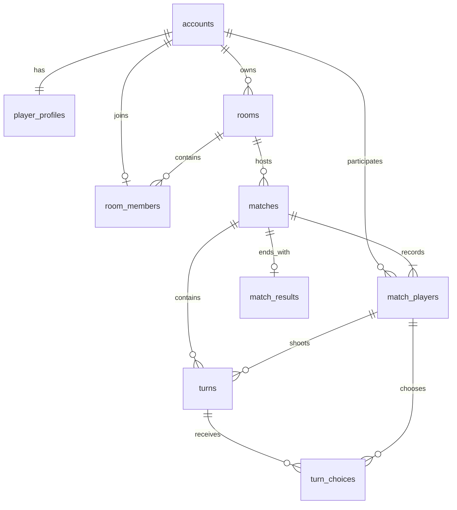

# Thiết kế MySQL — Game đá luân lưu hai người

## Phạm vi và lựa chọn thiết kế

Đăng ký/đăng nhập bằng username và mật khẩu; phòng có đúng hai vị trí; hai người luân phiên sút/bắt, mỗi bên 5 lượt rồi đá từng cặp nếu hòa. Lưu lịch sử, từng lựa chọn đã xác nhận và kết quả. MySQL 8.0.16 trở lên; InnoDB; kết nối ứng dụng đặt UTC và SQL strict mode.

Không đặt mục tiêu tách bảng theo một số cột cố định. Tách theo trách nhiệm và cách truy vấn. Thiết kế này có 9 bảng, mỗi bảng 3–7 cột; chưa lưu thống kê hay tỷ số trùng lặp nên giảm nguy cơ lệch dữ liệu. Đây là thiết kế phù hợp quy mô BTL, chưa phải kết luận tối ưu hiệu năng dựa trên tải thực tế.

## Danh mục bảng

| Bảng | Cột | Ý nghĩa |
|---|---|---|
| accounts | user_id, username, password_hash, status, created_at | Xác thực, khóa tài khoản |
| player_profiles | user_id, display_name, avatar_url | Hồ sơ công khai, không lẫn mật khẩu |
| rooms | room_id, room_code, owner_id, status, created_at | Phòng và mã tham gia |
| room_members | room_id, slot, user_id, is_ready, joined_at | Thành viên hiện tại, vị trí 1/2 |
| matches | match_id, room_id, status, first_shooter_slot, turn_timeout_seconds, started_at | Mỗi lần bắt đầu/chơi lại là một trận mới |
| match_players | match_id, slot, user_id | Hai người của trận, cố định sau khi bắt đầu |
| turns | match_id, turn_no, shooter_slot, deadline_at, outcome, resolution_reason, resolved_at | Một dòng là một cú sút |
| turn_choices | match_id, turn_no, player_slot, direction, chosen_at | Hướng chọn, tối đa hai dòng/lượt |
| match_results | match_id, winner_slot, end_reason, ended_at | Kết quả cuối trận, tối đa một dòng/trận |

PK là khóa chính; FK là khóa ngoại. Chi tiết kiểu dữ liệu, PK, FK, UNIQUE, CHECK và index nằm trong penalty_game_mysql.sql.

Sơ đồ thể hiện ý nghĩa nghiệp vụ. Database bảo đảm tối đa hai vị trí phòng/trận bằng PK và CHECK; ứng dụng bảo đảm đủ hai người trước khi bắt đầu. Quan hệ accounts–profiles được kỳ vọng 1–1: tạo cả hai trong cùng transaction; FK một mình không buộc mọi account phải có profile.

## Luật và cách biểu diễn

- slot là vị trí trong phạm vi phòng/trận, không phải user_id. slot trong trận được chụp từ phòng lúc bắt đầu; sau đó không thay đổi. owner_id xác định chủ phòng, không quyết định ai sút trước.
- turn_no 1–10: luân phiên hai người; mỗi người đúng 5 cú. shooter_slot lượt lẻ bằng first_shooter_slot, lượt chẵn là vị trí còn lại. Người còn lại là thủ môn, không cần cột keeper_id.
- Chỉ đánh giá thắng sau lượt 10 theo yêu cầu ảnh. Nếu hòa, tạo lượt 11 và 12; chỉ xét sau khi hoàn tất cả cặp. Tiếp tục 13–14… nếu vẫn hòa. Không đặt tổng số lượt cố định và không kết thúc sau cú đầu của một cặp đá thêm.
- Hướng LEFT/CENTER/RIGHT được hiểu theo cùng một góc nhìn sân của server. Hai giao diện cần ánh xạ thống nhất. Cùng hướng: SAVED; khác hướng: GOAL.
- outcome/resolution_reason/resolved_at cùng NULL nghĩa là đang chờ. Một lượt được chốt một lần. MISS dùng cho sút trượt do hết giờ; VOID dùng khi trận bị kết thúc trước khi giải quyết lượt đó.
- Đề xuất quy tắc hết giờ: người sút không chọn → MISS; chỉ thủ môn không chọn → GOAL; cả hai không chọn → MISS. Đây là lựa chọn thiết kế cần thống nhất trong luật game, không phải nội dung đã được quy định cụ thể trong ảnh.
- Mất kết nối: server giữ một khoảng chờ tái kết nối. Hết khoảng chờ, một người vắng → FORFEIT, người còn lại thắng; cả hai vắng → CANCELLED. Thời gian chờ do ứng dụng cấu hình.
- NORMAL/FORFEIT luôn có winner_slot và FK bảo đảm người thắng thuộc trận; CANCELLED luôn không có người thắng. Trận bị hủy không tính thắng/thua.
- Tỷ số được tính bằng số lượt GOAL theo shooter_slot; không suy ra thắng bằng tỷ số khi FORFEIT vì người thắng do bỏ cuộc có thể đang ít bàn hơn.
- UNIQUE user_id của room_members là giả định một người chỉ ở một phòng tại một thời điểm. Rời phòng xóa membership hiện tại; lịch sử vẫn tồn tại trong match_players.

## Dữ liệu realtime

MySQL lưu trạng thái bền vững: phòng, thành viên, trận, deadline, lựa chọn đã xác nhận, kết quả. Java quản lý WebSocket session, trạng thái kết nối, timer, hoạt ảnh, chat nhanh và yêu cầu chơi lại trong bộ nhớ. Chat nhanh trong phạm vi đề tài không yêu cầu lịch sử nên không cần bảng chat.

Chơi lại: cả hai đồng ý, server tạo match mới với hai match_players mới trong cùng phòng. match_id khác nên truy vấn WHERE room_id = ? ORDER BY match_id gom được chuỗi trận chơi lại. Đề nghị chơi lại trong bộ nhớ mất khi server khởi động lại; nếu sau này cần audit/lưu chat thì bổ sung bảng riêng.

Giữ lựa chọn trong MySQL không tự bảo đảm bí mật: server phải gửi DTO riêng. Trước khi chốt lượt, chỉ báo người nào đã chọn; tuyệt đối không trả direction của đối phương trong REST/WebSocket/log công khai. Server lấy user_id từ phiên đăng nhập, tự ánh xạ player_slot; không tin slot do client gửi. chosen_at là giờ server; không dùng đồng hồ client để xác định trễ.

## Transaction và xử lý đồng thời

Không giữ transaction mở trong lúc chờ WebSocket hay chờ người chơi.

1. Vào phòng: BEGIN → SELECT room WHERE room_code = ? FOR UPDATE → kiểm tra WAITING → chọn slot còn trống → INSERT room_members → COMMIT. PK ngăn trùng slot, UNIQUE user_id ngăn một người vào hai phòng; xử lý lỗi duplicate và mã phòng ngẫu nhiên bị trùng bằng phản hồi/thử lại phù hợp.
2. Bắt đầu: khóa room → kiểm tra chủ phòng, hai thành viên và cả hai sẵn sàng → kiểm tra không có trận PLAYING → tạo matches, hai match_players và lượt 1 → cập nhật room PLAYING → COMMIT.
3. Nhận lựa chọn: khóa matches rồi turns hiện tại theo thứ tự thống nhất → kiểm tra PLAYING, đúng lượt, người thuộc trận, lượt chưa chốt và chưa quá deadline theo giờ server → INSERT turn_choices. Không ghi đè khi client gửi lại: cùng lựa chọn trả xác nhận cũ, khác lựa chọn từ chối. Nếu đủ hai lựa chọn thì tính kết quả ngay trong transaction; nếu chưa đủ thì COMMIT, không chờ người kia.
4. Timer cũng khóa matches rồi turns và kiểm tra lại trước khi chốt. Vì dùng cùng khóa, timer và lựa chọn không thể chốt cùng lượt hai lần. Xử lý transaction ngắn và retry có giới hạn khi deadlock.
5. Chốt lượt: cập nhật turns đúng một lần → đánh giá luật → hoặc tạo lượt tiếp theo, hoặc INSERT match_results và cập nhật matches/rooms. Khi kết thúc bất thường, lượt còn mở được chốt VOID/MATCH_ENDED; lựa chọn đến sau bị từ chối. COMMIT rồi mới phát kết quả qua WebSocket.
6. Phát WebSocket sau commit có thể thất bại; khi reconnect, client lấy snapshot từ server/DB. Không coi phát sự kiện là điều kiện để commit thành công.
7. Server khởi động lại: truy vấn matches PLAYING, đọc lượt và deadline, khôi phục timer hoặc xử lý deadline đã qua. Quy mô nhỏ có thể quét matches; chỉ bổ sung index trạng thái/deadline khi có số liệu tải cần thiết.

Điều kiện phải kiểm tra trong Java: đủ đúng hai người; chủ phòng là thành viên; chỉ một trận đang chơi/phòng; thay chủ khi chủ rời phòng; cấm thay thành viên khi đang chơi hoặc xử lý bỏ cuộc trước; thứ tự/luân phiên lượt; một lượt mở/trận; cùng/khác hướng tương ứng kết quả; xét hòa sau đủ cặp; tính nhất quán matches.status và match_results. CHECK/FK hiện tại không thể tự kiểm tra toàn bộ các quy tắc nhiều dòng này. Mọi đường ghi và timer phải tuân theo giao thức khóa trên, kể cả tác vụ quản trị.

## Chỉ mục theo truy vấn

| Truy vấn | Chỉ mục chính |
|---|---|
| Đăng nhập | UNIQUE accounts(username) |
| Vào phòng bằng mã | UNIQUE rooms(room_code) |
| Thành viên phòng | PK room_members(room_id, slot) |
| Người đang ở phòng nào | UNIQUE room_members(user_id) |
| Các trận trong phòng | matches(room_id, match_id) |
| Lịch sử cá nhân | match_players(user_id, match_id) |
| Chi tiết lượt theo thứ tự | PK turns(match_id, turn_no) |
| Lựa chọn trong lượt | PK turn_choices(match_id, turn_no, player_slot) |
| Tỷ số từng người | turns(match_id, shooter_slot) |

Một số index khác phục vụ FK, không phải đề xuất index tràn lan. Không thêm index riêng cho direction, boolean is_ready, hay status chỉ vì chúng là cột lọc; cần xét toàn bộ truy vấn và độ chọn lọc.

SQL đính kèm có 7 truy vấn mẫu. Dùng prepared statements, không nối chuỗi đầu vào. Lịch sử phân trang bằng match_id giảm chi phí OFFSET lớn; thứ tự là thứ tự mã trận, không cam kết thứ tự kết thúc. JOIN kết quả có thể phải đọc qua các trận chưa kết thúc/bị lọc, nên hiệu quả thực tế cần đo.

Thống kê cá nhân tính từ match_results và match_players; phù hợp BTL và tránh bộ đếm lệch khi retry. Nếu dữ liệu đủ lớn và có leaderboard thường xuyên, cân nhắc player_stats(user_id, played, wins, losses), cập nhật cùng transaction kết thúc trận đúng một lần và có tác vụ đối soát. Không cần bảng này ngay từ đầu.

## Lưu ý triển khai và kiểm chứng

- username giả định ASCII, không phân biệt hoa/thường; tên hiển thị hỗ trợ tiếng Việt. avatar_url tùy chọn. Không thêm email, ngày sinh, địa chỉ khi chức năng chưa yêu cầu.
- Chỉ lưu mật khẩu hash, ví dụ BCrypt; không lưu mật khẩu thô. Có thể dùng Spring Security BCrypt mà vẫn tự viết SQL bằng JDBC.
- Không hard-delete tài khoản/phòng/trận có lịch sử; FK mặc định hạn chế xóa. Khóa account bằng status; đóng phòng bằng CLOSED; thay đổi username/display_name sẽ hiển thị tên hiện tại trong lịch sử. Nếu cần tên tại thời điểm thi đấu, bổ sung display_name_snapshot vào match_players.
- Mã phòng sinh ngẫu nhiên phía server, 8 ký tự chữ hoa/số, thử lại khi trùng; không dùng mã phòng làm bằng chứng xác thực người chơi.
- Thời lượng 15 giây là mặc định gợi ý, có thể đổi lúc tạo trận; deadline_at lưu hạn tuyệt đối của từng lượt.
- Các truy vấn ví dụ là comment để chạy file schema không vô tình đọc dữ liệu hoặc đòi tham số. Thay ? bằng giá trị thử trong Workbench; trong Java giữ ? và bind tham số.
- Chưa chạy DDL trên MySQL thực trong phiên này vì môi trường không có MySQL server/client. Cần chạy file trên database thử, dùng EXPLAIN ANALYZE với dữ liệu đại diện cho truy vấn lịch sử/tỷ số; kiểm tra race khi hai người vào phòng/submit/timeout đồng thời. Không khẳng định tối ưu tuyệt đối chỉ từ schema.

Tài liệu tham chiếu chính thức: https://dev.mysql.com/doc/refman/8.4/en/create-table-foreign-keys.html và https://dev.mysql.com/doc/refman/8.4/en/create-table-check-constraints.html.
