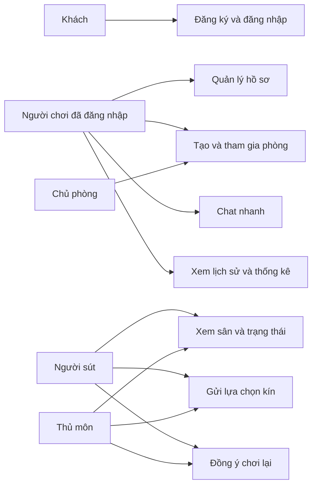
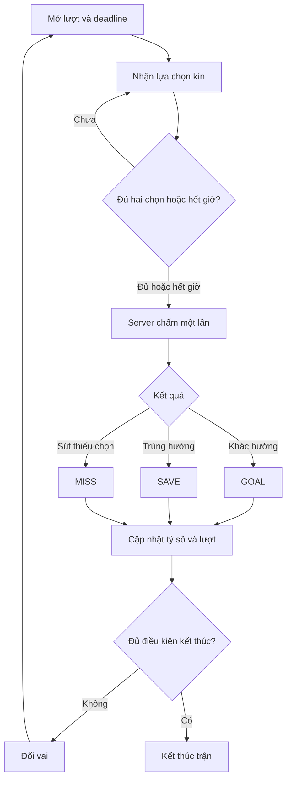
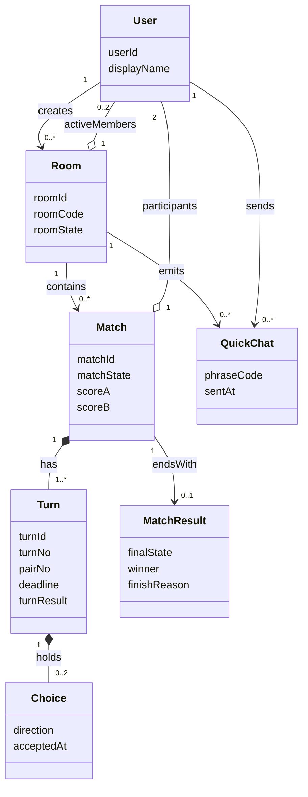
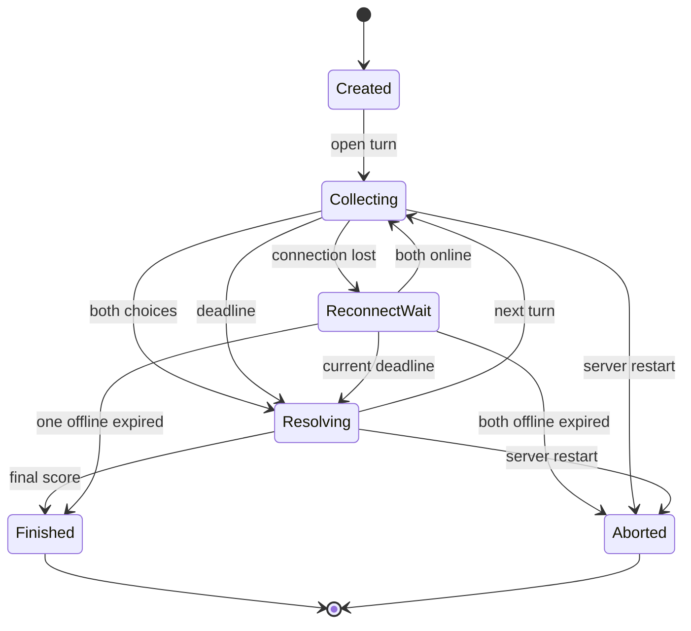
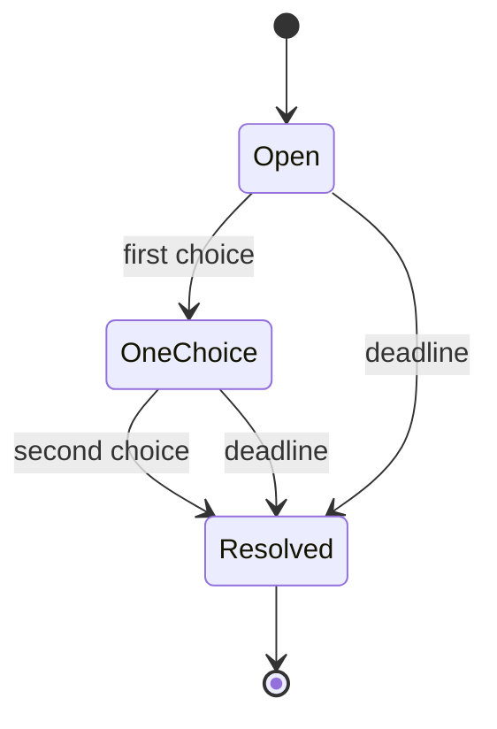
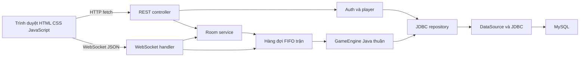
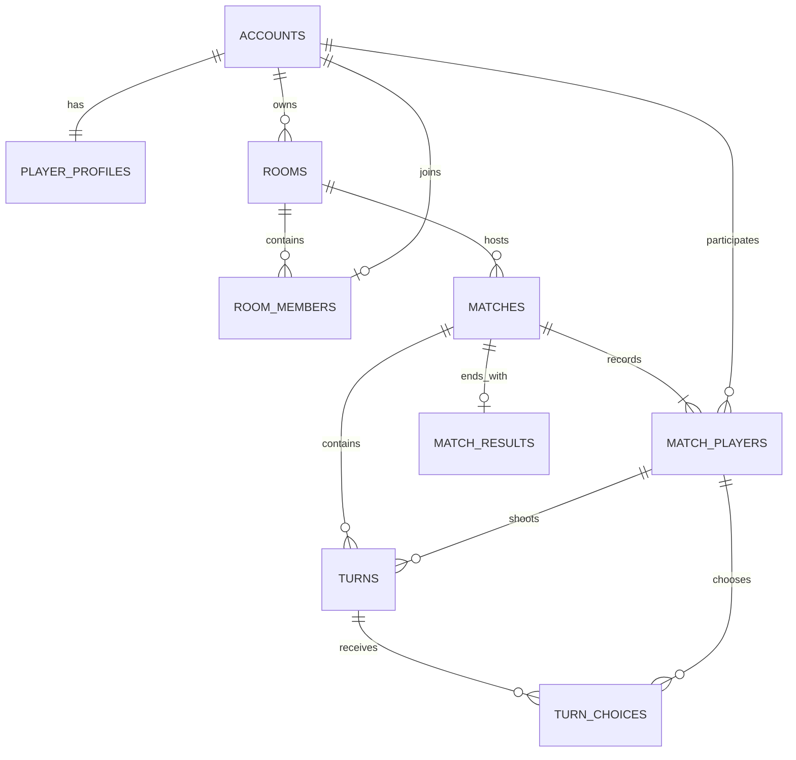
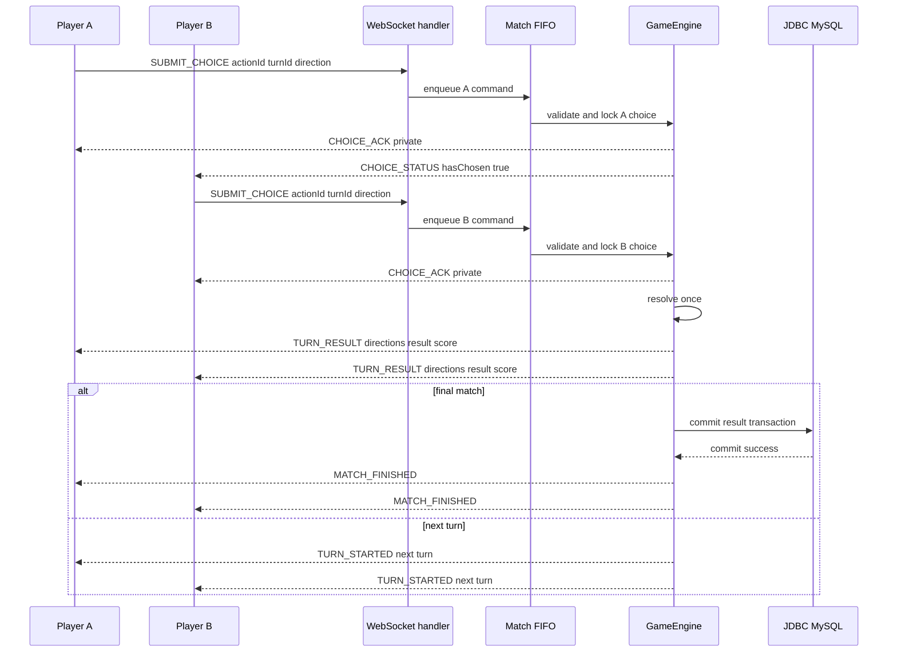
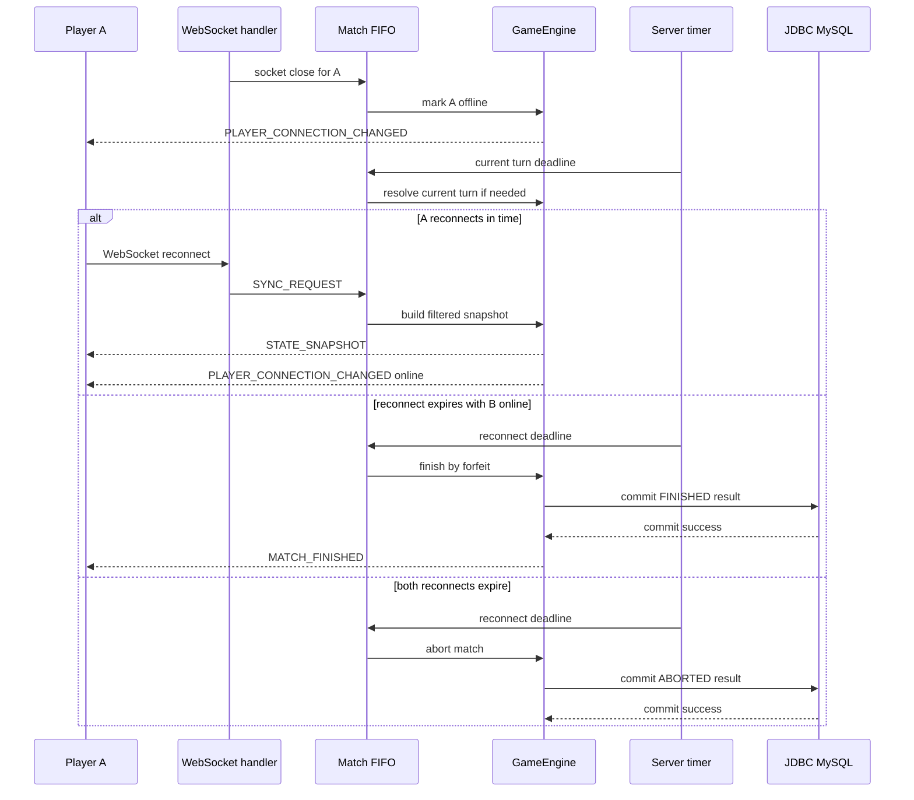

# BÁO CÁO DỰ ÁN GAME ĐÁ LUÂN LƯU 2 NGƯỜI

## Thông tin và phiên bản

| Nội dung | Giá trị |
| --- | --- |
| Tên đề tài | Game đá luân lưu 2 người dùng Java Spring Boot, WebSocket, HTML/CSS/JavaScript thuần và MySQL |
| Tài liệu đang có | `docs/Bo_prompt_Codex_10_giai_doan_Game_da_luan_luu.md`; `docs/CODEX_RULES.md`; `docs/Quy_trinh_xay_dung_phan_mem_chi_tiet.md` |
| Tài liệu nguồn quy trình | `docs/Quy_trinh_xay_dung_phan_mem_chi_tiet.md`, đã đọc Mục 2 trong Phần 2 |
| Thời điểm cập nhật | 17/11/2026 (Asia/Ho_Chi_Minh) |
| Phiên bản/commit được xem xét | `1a9aed6` (`Initial commit`) và các thay đổi chưa commit tại thời điểm rà soát |
| Giai đoạn và điểm dừng hiện tại | Bước 2 (Mục 8.1) — đã có đăng ký/đăng nhập/đăng xuất dùng BCrypt, session và `JdbcTemplate`; chờ MySQL hợp lệ để kiểm tra end-to-end, chưa chuyển sang Bước 3 |

## Mục lục

1. [Hiểu quy trình và kiểm kê](#1-hiểu-quy-trình-và-kiểm-kê)
2. [Nghiên cứu bài toán](#2-nghiên-cứu-bài-toán)
3. [Mục tiêu, phạm vi và khả thi](#3-mục-tiêu-phạm-vi-và-khả-thi)
4. [Đặc tả yêu cầu](#4-đặc-tả-yêu-cầu)
5. [Phân tích hệ thống](#5-phân-tích-hệ-thống)
6. [Thiết kế hệ thống](#6-thiết-kế-hệ-thống)
7. [Kế hoạch và môi trường](#7-kế-hoạch-và-môi-trường)
8. [Lập trình và tích hợp](#8-lập-trình-và-tích-hợp)
9. [Kiểm thử và sửa lỗi](#9-kiểm-thử-và-sửa-lỗi)
10. [Nghiệm thu](#10-nghiệm-thu)

## Bảng tiến độ

| Phần | Trạng thái | Đầu ra/bằng chứng | Tồn đọng |
| --- | --- | --- | --- |
| 1 | HOÀN THÀNH CÓ GIỚI HẠN | Kiểm kê thư mục, quy tắc làm việc, lộ trình 10 giai đoạn trong báo cáo này | Chưa có tài liệu quy trình nguồn |
| 2 | HOÀN THÀNH CÓ GIỚI HẠN | Nghiên cứu bàn giấy, nguồn kỹ thuật, câu hỏi khảo sát và kịch bản quan sát | Chưa có phỏng vấn, khảo sát hay quan sát prototype thực tế |
| 3 | HOÀN THÀNH CÓ GIỚI HẠN | Mục tiêu kiểm chứng được, phạm vi ba mức, khả thi/rủi ro và kế hoạch kiểm chứng | Chưa có thông tin nhóm, hạn nộp, môi trường hay kết quả thử nghiệm kỹ thuật |
| 4 | HOÀN THÀNH CÓ GIỚI HẠN | FR-01–FR-12, NFR, BR, user story, thuật ngữ và truy vết ban đầu | Tham số thời gian và chính sách restart chưa có xác nhận giảng viên/người dùng |
| 5 | HOÀN THÀNH CÓ GIỚI HẠN | Tác nhân, use case, mô hình miền, trạng thái, phân tích đồng thời và sơ đồ Mermaid | Sơ đồ chưa render xác minh; chính sách restart vẫn là giả định AD-12 |
| 6 | HOÀN THÀNH CÓ GIỚI HẠN | Thiết kế MySQL 9 bảng: tài khoản, hồ sơ, phòng, trận, lượt, lựa chọn và kết quả | DDL/chỉ mục/truy vấn mới chỉ được rà tĩnh; chưa chạy trên MySQL hoặc render ERD |
| 7 | HOÀN THÀNH CÓ GIỚI HẠN | Project Spring Boot Java 21, Maven Wrapper 3.9.11, cấu hình `JdbcTemplate`, endpoint kiểm tra DB và context test PASS | Chưa có MySQL client/tài khoản/database phát triển để kiểm tra kết nối thật; WebSocket và nghiệp vụ chưa triển khai |
| 8 | HOÀN THÀNH CÓ GIỚI HẠN (8.1) | Đăng ký/đăng nhập/đăng xuất, BCrypt, phiên HTTP, SQL `JdbcTemplate`, giao diện tối giản và context test PASS | Chưa kiểm tra luồng với MySQL thật do xác thực DB đang thất bại; các bước 8.2–8.6 chưa làm |
| 9 | CHƯA THỰC HIỆN |  |  |
| 10 | CHƯA THỰC HIỆN |  |  |

## Giả định và quyết định hiện hành

| Mã | Nội dung | Cơ sở | Trạng thái chốt | Ảnh hưởng |
| --- | --- | --- | --- | --- |
| AD-01 | Đi theo 10 giai đoạn, chỉ làm đúng phần người dùng yêu cầu | Prompt Phần 1 và `CODEX_RULES.md` | Đã chốt bởi người dùng | Không tự chuyển sang phần tiếp theo |
| AD-02 | Đề tài minh họa là game đá luân lưu hai người | Quy tắc chung do người dùng cung cấp | Đã chốt bởi người dùng | Là phạm vi sản phẩm dự kiến |
| AD-03 | Backend dùng Spring Boot, WebSocket, SQL tự viết qua `JdbcTemplate` và MySQL; frontend thuần | Yêu cầu hiện hành của người dùng | Đã chốt bởi người dùng | Không dùng JPA/Hibernate; các truy vấn vẫn dùng tham số an toàn |
| AD-04 | Tài liệu quy trình nguồn ở `docs/Quy_trinh_xay_dung_phan_mem_chi_tiet.md`; Mục 2 đã được đọc | File có trong workspace, kiểm tra ngày 08/11/2026 | Đã xác nhận vị trí | Phần 2 bám mục “Xác định bài toán và nghiên cứu thực tế” của tài liệu nguồn |
| AD-05 | Các tham số 15 giây chọn, 30 giây reconnect, khoảng 2 giây hoạt ảnh chỉ là mặc định minh họa | Quy tắc chung do người dùng cung cấp | Chưa được giảng viên xác nhận | Chưa áp dụng vào triển khai |
| AD-06 | Chưa có dữ liệu từ người chơi; nhận định trải nghiệm trong Phần 2 là giả thuyết cần khảo sát | Chưa có biên bản phỏng vấn/quan sát | Chưa chốt | Không suy rộng thành nhu cầu thị trường hoặc kết quả kiểm thử |
| AD-07 | MVP kỹ thuật chỉ kiểm chứng luồng trận lõi; không đồng nghĩa hoàn thành đề tài | Mục 3.2 tài liệu nguồn | Đã xác lập theo tài liệu nguồn | Bản cuối vẫn phải có tài khoản, chat nhanh, lịch sử/thống kê và xử lý mất kết nối |
| AD-08 | Server một tiến trình; frontend cùng origin, JavaScript thuần; JDBC/SQL tự viết, không ORM | Quy tắc chung do người dùng cung cấp | Đã chốt bởi người dùng | Giới hạn lựa chọn kiến trúc và dependency trong các phần sau |
| AD-09 | Quy mô nhóm, hạn nộp, MySQL/môi trường chạy và ngân sách chưa được cung cấp | Thông tin hiện có | Chưa chốt | Đánh giá thời gian, thiết bị, vận hành và chi phí chỉ là sơ bộ |
| AD-10 | Chưa đặt chỉ tiêu độ trễ/tải định lượng | Chưa có môi trường, cách đo hay quy mô tải được chốt | Chưa chốt | Không tuyên bố một chỉ số hiệu năng đã đạt |
| AD-11 | 15 giây chọn, 30 giây reconnect và khoảng 2 giây hoạt ảnh là mặc định thiết kế minh họa | Quy tắc chung và Mục 4 tài liệu nguồn | Chưa được giảng viên duyệt | Dùng trong BR-07 đến BR-10, không coi là thông số đã nghiệm thu |
| AD-12 | Cần thống nhất chính sách restart và tên trạng thái hủy: các phần đặc tả cũ dùng `ABORTED`, còn DDL hiện hành dùng `CANCELLED` | Đối chiếu báo cáo với `penalty_game_mysql.sql` ngày 10/11/2026 | Chưa chốt | Phải đồng bộ SRS, DDL, JDBC, WebSocket và test trước khi triển khai |
| AD-13 | Kết quả lượt được server chấm và cố định trước; hoạt ảnh frontend chỉ trình bày kết quả và không là trạng thái quyết định luật | FR-08, FR-09, BR-03 và phân tích Phần 5 | Đã chốt bởi yêu cầu hiện hành | Không chờ hoạt ảnh để chuyển/đóng trạng thái Match; callback hoạt ảnh không được mở lại trận |
| AD-14 | DDL hiện hành lưu phòng, thành viên phòng, trận, lượt, lựa chọn và kết quả trong MySQL | `database/penalty_game_mysql.sql` và `database/Thiet_ke_CSDL_da_luan_luu.md` | Đã phản ánh theo file hiện có | `room_id` và chi tiết lượt là dữ liệu bền vững; triển khai vẫn phải kiểm soát trạng thái realtime và quyền truy cập |
| AD-15 | Mọi lệnh/timer thay đổi một trận đi qua một hàng đợi FIFO của chính trận đó; chỉ worker của hàng đợi sửa `MatchState` | R-02, NFR-02 và thiết kế Phần 6 | Đã chốt cho thiết kế Phần 6 | Dễ giải thích trong một server; không phù hợp khi mở rộng nhiều tiến trình |
| AD-16 | Bộ khung dùng Java 21 và Spring Boot 4.1.2 | Java 21.0.11 đã phát hiện; tài liệu Spring Boot chính thức nêu 4.1.2 hỗ trợ Java 17–27 và Maven 3.6.3+ | Đã chốt cho bộ khung hiện tại | Cần Maven 3.6.3+ hoặc wrapper thật để tải dependency/build |
| AD-17 | `application.properties` nhận `SERVER_PORT`, `DB_URL`, `DB_USERNAME`, `DB_PASSWORD`; không tự chạy DDL | Cấu hình Bước 1 | Đã chốt cho bộ khung | Không chứa bí mật; kiểm tra kết nối chỉ thực hiện khi gọi endpoint sức khỏe |
| AD-18 | Repository dùng Maven Wrapper `only-script`, Maven 3.9.11; Maven local repository nằm tại `penalty_game/.mvn/repository` | Wrapper đã sửa và `mvnw.cmd test` ngày 10/11/2026 | Đã xác nhận thực tế | Không cần Maven hệ thống; dependency tải vào thư mục đã bị Git bỏ qua |
| AD-19 | POM dùng Web MVC, JDBC, MySQL Connector và BCrypt; không có JPA/Hibernate, Lombok, DevTools, Redis hoặc Docker | `penalty_game/pom.xml` sau Bước 2 | Đã chốt theo yêu cầu hiện tại | WebSocket chỉ thêm ở đúng bước có nhu cầu |
| AD-20 | Bước 2 chỉ thêm `spring-security-crypto` để dùng BCrypt, không thêm toàn bộ Spring Security | Yêu cầu BCrypt nhưng cần giữ mã đơn giản, dễ giải thích | Đã áp dụng | Xác thực do controller/service tự xử lý qua `HttpSession`; endpoint thay đổi dữ liệu kiểm tra CSRF token đơn giản |

## 1. Hiểu quy trình và kiểm kê

### Mục tiêu

Xác lập cách làm có kiểm soát phạm vi, kiểm kê trung thực hiện trạng dự án và tạo báo cáo chung để theo dõi 10 giai đoạn. Phần này không triển khai ứng dụng.

### Đầu vào

- Yêu cầu thực hiện Phần 1 của người dùng.
- `docs/CODEX_RULES.md` đã được đọc lại trước khi thực hiện.
- `docs/Bo_prompt_Codex_10_giai_doan_Game_da_luan_luu.md` là bộ prompt định hướng công việc.
- `README.md` hiện có nội dung tiêu đề `# Lap_trinh_mang`.

### Kết quả kiểm kê thực tế

| Hạng mục | Kết quả |
| --- | --- |
| Thư mục dự án | `D:\Lap_trinh_mang` |
| `AGENTS.md` | Không tồn tại tại thư mục gốc; không có chỉ dẫn cục bộ bổ sung để đọc |
| Tài liệu quy trình `Quy_trinh_xay_dung_phan_mem_chi_tiet.md` | Không tồn tại trong workspace; chưa đọc tài liệu này |
| Mã Java/Spring Boot | Chưa có: không có `pom.xml`, `build.gradle`, `src/` hay mã Java được tìm thấy |
| Frontend | Chưa có: không có HTML/CSS/JavaScript ứng dụng |
| Cấu hình | Chưa có cấu hình ứng dụng như `application.properties`/`application.yml` |
| SQL/database | Chưa có thư mục hay script SQL/database |
| Tài liệu hiện có | `README.md`, `docs/Bo_prompt_Codex_10_giai_doan_Game_da_luan_luu.md`, `docs/CODEX_RULES.md` |
| Thay đổi trong Phần 1 | Tạo duy nhất `docs/BAO_CAO_DU_AN.md`; không xóa, di chuyển, tái cấu trúc hay sửa mã ứng dụng |

### Cách hiểu đề tài và sản phẩm dự kiến

Mục tiêu là đi tuần tự qua các mục 1–10 của quy trình xây dựng phần mềm; không phải hoàn thành toàn bộ game ngay trong một lần. Sản phẩm dự kiến là một game đá luân lưu cho đúng hai người chơi trong cùng phòng. Hai người chọn hướng trái/giữa/phải một cách kín; server là nơi duy nhất chấm bàn thắng hoặc cản phá, điều phối lượt và đồng bộ trạng thái.

Vai trò của từng phần dự kiến:

| Thành phần | Vai trò |
| --- | --- |
| Frontend HTML/CSS/JavaScript | Hiển thị trang đăng nhập, phòng, sân ba hướng, đồng hồ và kết quả; gửi thao tác người chơi bằng HTTP/WebSocket; không tự chấm luật hoặc tự cộng tỷ số |
| Server Spring Boot | Phục vụ frontend cùng origin, xử lý HTTP, quản lý phiên, xác thực/quyền và điều phối nghiệp vụ |
| WebSocket | Truyền sự kiện thời gian thực giữa hai người chơi, ví dụ trạng thái phòng, xác nhận chọn và kết quả lượt; chỉ phát dữ liệu công khai phù hợp từng thời điểm |
| Luật chơi Java thuần | Giữ trạng thái trận, lượt, vai sút/thủ và chấm theo quy tắc; tách khỏi controller/handler để dễ đọc và kiểm thử độc lập |
| MySQL + `JdbcTemplate` | Lưu tài khoản và kết quả/lịch sử; truy cập bằng SQL tự viết, bind tham số và transaction khi cần |

**Phân biệt trạng thái:** “phần mềm chạy” chỉ chứng tỏ một lệnh khởi động hay luồng kỹ thuật cụ thể đã chạy trong một môi trường. “Đáp ứng yêu cầu đã kiểm chứng” cần có yêu cầu/tiêu chí chấp nhận, ca kiểm thử hoặc kịch bản phù hợp, bằng chứng kết quả thật và ghi nhận giới hạn. Tại Phần 1 chưa có phần mềm để chạy, vì vậy không có kết luận kiểm thử hay nghiệm thu.

### Lộ trình 10 giai đoạn

| Phần | Mục tiêu | Đầu vào chính | Đầu ra dự kiến | Điều kiện hoàn thành | Giới hạn công việc |
| --- | --- | --- | --- | --- | --- |
| 1 | Hiểu quy trình, kiểm kê và thống nhất cách làm | Quy tắc, tài liệu hiện có, yêu cầu đề tài | Báo cáo khởi tạo, hiện trạng, lộ trình | Có kiểm kê thực tế và điểm dừng rõ | Không viết ứng dụng, không làm Phần 2 |
| 2 | Nghiên cứu bài toán và căn cứ | Phạm vi đề tài, nguồn kỹ thuật/khảo sát nếu có | Bối cảnh, vấn đề, bằng chứng, câu hỏi khảo sát | Phân biệt rõ dữ liệu có thật với giả thuyết | Không dựng ứng dụng hay tự khảo sát thay người dùng |
| 3 | Xác định mục tiêu, phạm vi và khả thi | Kết quả Phần 2, quy tắc | Mục tiêu, phạm vi, rủi ro, tiêu chí khả thi | Có ranh giới MVP và cách kiểm chứng | Không viết code hoặc tự thử kỹ thuật ngoài phạm vi |
| 4 | Đặc tả yêu cầu | Phần 2–3 | FR/NFR/BR và tiêu chí chấp nhận | Yêu cầu, luật và quyền được diễn đạt kiểm chứng được | Không triển khai ứng dụng |
| 5 | Phân tích hệ thống | Yêu cầu Phần 4 | Tác nhân, trạng thái, mô hình miền và sơ đồ phân tích | Luồng nghiệp vụ và trạng thái nhất quán | Không viết ứng dụng |
| 6 | Thiết kế hệ thống | Phân tích Phần 5 | Kiến trúc, ERD, SQL thiết kế, giao thức và giao diện | Thiết kế/sơ đồ phù hợp yêu cầu; SQL chỉ ở mức thiết kế | Không triển khai nghiệp vụ chạy thật |
| 7 | Chuẩn bị môi trường và kế hoạch lập trình | Thiết kế đã chốt | Khung dự án, cấu hình mẫu, hướng dẫn, backlog | Build/smoke môi trường theo khả năng và ghi kết quả thật | Không triển khai nghiệp vụ game |
| 8 | Lập trình, tích hợp theo 8.1–8.6 | Thiết kế, SQL, khung Phần 7 | Mã nguồn, SQL sử dụng, kiểm tra từng điểm dừng | Mỗi điểm dừng có code/bằng chứng riêng; chỉ hoàn tất khi đủ 8.1–8.6 | Mỗi lần chỉ làm một điểm dừng; không sang Phần 9 sớm |
| 9 | Kiểm thử và sửa lỗi | Code Phần 8, tiêu chí Phần 4 | Kế hoạch test, kết quả, bug, sửa lỗi và truy vết | Kết quả PASS/FAIL/BLOCKED/NOT RUN có bằng chứng | Không thêm tính năng mới để làm đủ phạm vi |
| 10 | Chuẩn bị và ghi nhận nghiệm thu | Báo cáo Phần 4–9, phiên bản code | Kịch bản demo, checklist, kết quả/xác nhận thật | Kết luận có điều kiện, không ký thay người dùng/giảng viên | Không deploy công khai hay tự sang giai đoạn sau |

### Nhịp làm việc và kiểm soát phạm vi

- Làm theo lát cắt nhỏ: một prompt tương ứng đúng một phần hoặc một điểm dừng 8.x; kết thúc bằng cập nhật báo cáo và dừng.
- Trước mỗi phần, đọc `CODEX_RULES.md`, phần báo cáo liên quan và các file thực tế cần thiết; sau mỗi phần, đối chiếu báo cáo với file đã tạo/sửa.
- Demo chỉ được đề xuất sau khi có phần mềm hoặc kết quả thực tế phù hợp. Không có bằng chứng nào cho thấy nhóm áp dụng Scrum đầy đủ, nên chỉ dùng nhịp làm việc nhỏ và demo thường xuyên như một cách tổ chức công việc, không gắn nhãn Scrum.
- Không sang giai đoạn kế tiếp, không thêm framework/dependency, không viết code ứng dụng khi chưa có prompt tương ứng.

### Nguyên tắc kỹ thuật đã chốt cho các phần sau

- Java rõ nghĩa, ưu tiên cấu trúc đơn giản; luật chơi Java thuần và tách khỏi lớp HTTP/WebSocket.
- SQL DDL/DML tự viết qua `JdbcTemplate`, bind tham số và transaction rõ ràng; không dùng JPA/Hibernate.
- Frontend HTML/CSS/JavaScript thuần; dùng `fetch` và WebSocket trình duyệt, không tự thêm framework frontend.
- Chỉ thêm dependency thật sự cần thiết theo quy tắc chung; không dùng JPA/Hibernate/Spring Data Repository, MyBatis, Lombok, MapStruct, Redis, message broker hay microservices. BCrypt chỉ xem xét khi sang chức năng tài khoản và phải nêu lý do.

### File thay đổi

| File | Thay đổi |
| --- | --- |
| `docs/BAO_CAO_DU_AN.md` | Tạo báo cáo tổng hợp, điền Mục 1, để Mục 2–10 ở trạng thái CHƯA THỰC HIỆN |
| `docs/CODEX_RULES.md` | Đã có từ bước lưu quy tắc trước Phần 1; được đọc lại, không sửa trong Phần 1 |

### Kiểm tra và bằng chứng

1. Đã đọc `docs/CODEX_RULES.md` trước khi kiểm kê.
2. Đã kiểm tra `AGENTS.md`: không tồn tại.
3. Đã kiểm kê bằng danh sách file/thư mục: chỉ có `README.md` và hai tài liệu trong `docs/`; không có mã nguồn, build file, cấu hình hoặc SQL.
4. Đã kiểm tra tài liệu nguồn `docs/Quy_trinh_xay_dung_phan_mem_chi_tiet.md`: không tồn tại.
5. Không chạy build, test hay database vì chưa có ứng dụng, dependency, script SQL hoặc cấu hình để chạy.

### Giả định, hạn chế và tồn đọng

- Hạn chế chính: tài liệu `Quy_trinh_xay_dung_phan_mem_chi_tiet.md` chưa có nên Phần 1 chưa thể đối chiếu nội dung quy trình gốc; lộ trình hiện dựa trên bộ prompt người dùng đã cung cấp.
- Chưa có yêu cầu bổ sung nào làm thay đổi đề tài, công nghệ hay các điểm dừng.
- Không có mã ứng dụng để đánh giá chất lượng, bảo mật, kết nối MySQL hoặc hoạt động WebSocket.

### Trạng thái và điểm dừng

**HOÀN THÀNH CÓ GIỚI HẠN** — Đã hoàn tất kiểm kê, xác lập cách làm, lộ trình và báo cáo tổng hợp. Giới hạn là thiếu tài liệu quy trình nguồn.  
**Bước tiếp theo: CHỜ YÊU CẦU** cho Phần 2; không tự bắt đầu.

## 2. Nghiên cứu bài toán

### Mục tiêu

Mô tả trung thực bối cảnh và các vấn đề cần giải quyết trước khi chọn giải pháp kỹ thuật; xác định rõ nội dung nào là yêu cầu đề tài, giả thuyết về trải nghiệm hay rủi ro kỹ thuật. Phần này là nghiên cứu bàn giấy, không phải kết quả khảo sát người chơi.

### Đầu vào

- `docs/CODEX_RULES.md` và báo cáo hiện tại.
- Mục 2 “Xác định bài toán và nghiên cứu thực tế” trong `docs/Quy_trinh_xay_dung_phan_mem_chi_tiet.md`.
- Phạm vi đề tài do người dùng cung cấp: game đá luân lưu hai người, chọn kín, server chấm và có xử lý deadline/mất kết nối.

### Bối cảnh, người dùng và mục tiêu học tập

Đây là đồ án lập trình mạng, trong đó sản phẩm minh họa là một trận đá luân lưu ngắn giữa hai người qua trình duyệt. Nhóm người chơi mục tiêu ở mức đề tài là **hai người muốn vào cùng một phòng để chơi với nhau**. Giảng viên là bên đánh giá yêu cầu môn học, không phải người chơi mục tiêu.

Mục tiêu học tập là thực hành giao tiếp client–server, kết nối thời gian thực, trạng thái dùng chung, xác thực/quyền và xử lý tình huống đồng thời hoặc mất kết nối. Các mục tiêu này **không phải** bằng chứng rằng thị trường có nhu cầu cao với một game mới, cũng không chứng minh hành vi hay mức hài lòng của người chơi. Chưa có phỏng vấn, khảo sát hoặc log sử dụng thật trong dự án.

### Vấn đề cần tìm hiểu

| Mã | Vấn đề phù hợp | Yêu cầu đã có trong đề tài | Giả thuyết về trải nghiệm cần khảo sát | Rủi ro kỹ thuật dự kiến, chưa phải lỗi đã quan sát | Bằng chứng hiện có và giới hạn |
| --- | --- | --- | --- | --- | --- |
| P-01 | Mời đúng đối thủ vào một trận | Tạo/tham gia phòng bằng mã, tối đa đúng 2 người | Người chơi có thể cần mã phòng dễ chia sẻ và thông báo rõ phòng đã đủ/chưa đủ người | Hai yêu cầu tham gia gần đồng thời có thể tranh suất cuối; lệnh từ người ngoài cần bị từ chối | Tài liệu nguồn nêu việc xác định cách mời bạn là nội dung cần phỏng vấn. Chưa có thử người chơi hay kiểm tra đồng thời thực tế |
| P-02 | Giữ kín hướng trái/giữa/phải trước công bố | Hai bên chọn kín; chỉ server chấm | Người chơi có thể cần xác nhận riêng rằng lựa chọn đã được nhận nhưng không biết hướng đối thủ | Payload/snapshot hoặc thông báo sai đối tượng có thể làm lộ hướng; không quy ước thông điệp rõ có thể gây hiểu sai | Tài liệu nguồn mô tả đây là tình huống cần thử nghiệm. Tài liệu Spring xác nhận WebSocket không tự quy định ngữ nghĩa nội dung thông điệp, nên quy ước ứng dụng sẽ cần được thiết kế; chưa có payload hay test thực tế |
| P-03 | Hai máy thống nhất lượt, vai và kết quả | Server giữ vai, tỷ số, deadline và kết quả; client không tự chấm | Người chơi có thể nhầm lượt hoặc bấm lại nếu chưa thấy trạng thái xác nhận | Thứ tự sự kiện, gửi lặp hoặc kết nối cũ có thể làm trạng thái hai phía lệch nếu server không kiểm soát | Tài liệu nguồn yêu cầu thử lựa chọn đồng thời và quan sát việc nhận biết lượt. WebSocket hỗ trợ trao đổi hai chiều nhưng không tự giải quyết luật/trạng thái; chưa có log hai client |
| P-04 | Trận không treo khi thiếu lựa chọn hoặc mất mạng | Deadline, chính sách thiếu lựa chọn, kết nối lại và hủy trận đã được nêu trong quy tắc | Người chơi có thể cần biết đang chờ gì, còn bao lâu và điều gì xảy ra khi đối thủ mất kết nối | Socket có thể đóng/lỗi; timer muộn hoặc không được điều phối với lệnh chọn có thể giải quyết lượt sai hay làm trận không tiến triển | Tài liệu nguồn yêu cầu hỏi về mất mạng. API WebSocket có sự kiện `close`/`error`, nhưng đây chỉ là khả năng giao thức/trình duyệt, không chứng minh trải nghiệm hay xử lý của ứng dụng |

### Bằng chứng và trạng thái thu thập

| Mã | Phát hiện hoặc nội dung cần xác minh | Nguồn / cách thu thập | Thời điểm | Trạng thái | Giới hạn |
| --- | --- | --- | --- | --- | --- |
| EV-01 | Người chơi mục tiêu là hai người muốn chơi qua trình duyệt; cần hỏi cách mời bạn, thời gian chờ, nhận biết lượt và mất mạng | Mục 2.2 của tài liệu quy trình nguồn | Đọc 08/11/2026 | Có tài liệu định hướng | Là yêu cầu nghiên cứu của tài liệu, không phải dữ liệu hành vi người chơi |
| EV-02 | Các khó khăn về nhận biết đã chọn, không đồng bộ trạng thái và bấm lại là giả thuyết cần khảo sát | Mục 2.3 của tài liệu quy trình nguồn | Đọc 08/11/2026 | Có tài liệu định hướng | Chưa có biên bản khảo sát hoặc quan sát để xác nhận |
| EV-03 | WebSocket là kênh giao tiếp hai chiều; ứng dụng phải tự thống nhất ngữ nghĩa thông điệp | [Spring Framework — WebSockets](https://docs.spring.io/spring-framework/reference/web/websocket.html) | Truy cập 08/11/2026 | Đã đọc nguồn kỹ thuật | Không chứng minh game này hoạt động đúng, không thay thế thiết kế giao thức hoặc test hai client |
| EV-04 | WebSocket sử dụng mô hình bảo mật dựa trên origin và có bắt tay mở kết nối | [RFC 6455 — The WebSocket Protocol](https://www.rfc-editor.org/rfc/rfc6455) | Truy cập 08/11/2026 | Đã đọc nguồn tiêu chuẩn | Không tự bảo đảm xác thực thành viên phòng hoặc kiểm tra quyền của ứng dụng |
| EV-05 | Mức độ dễ hiểu vai, trạng thái đã chọn, thời gian chờ và cách xử lý mất mạng | Phỏng vấn ngắn và quan sát prototype với hai người chơi | Chưa thực hiện | **CHƯA THU THẬP** | Không thay bằng số liệu minh họa hoặc suy đoán |
| EV-06 | Cách hai client nhận lựa chọn, kết quả và trạng thái sau reconnect | Log kỹ thuật, ảnh hai trình duyệt và test sau khi có ứng dụng | Chưa thực hiện | **CHƯA THU THẬP** | Thuộc giai đoạn lập trình/kiểm thử sau, chưa thể kết luận ở Phần 2 |

### Nguồn kỹ thuật đã tra cứu

| Nguồn | URL | Ngày truy cập | Nhận định được nguồn hỗ trợ | Giới hạn khi dùng trong báo cáo |
| --- | --- | --- | --- | --- |
| Spring Framework Reference — WebSockets | https://docs.spring.io/spring-framework/reference/web/websocket.html | 08/11/2026 | WebSocket là kênh hai chiều; sau khi kết nối, thông điệp chạy trên cùng kết nối và cần có quy ước ngữ nghĩa ở tầng ứng dụng | Không phải nghiên cứu người dùng, không chứng minh xử lý lượt hay an toàn của ứng dụng cụ thể |
| RFC 6455 — The WebSocket Protocol | https://www.rfc-editor.org/rfc/rfc6455 | 08/11/2026 | Chuẩn mô tả giao tiếp hai chiều, handshake và mô hình origin của WebSocket | Không thay thế việc kiểm tra session, quyền phòng và Origin theo thiết kế ứng dụng |
| MDN WebSocket API | https://developer.mozilla.org/en-US/docs/Web/API/WebSocket | 08/11/2026 | API trình duyệt có các sự kiện `open`, `message`, `error`, `close` và trạng thái kết nối | Không xác nhận hành vi khi mạng thật sự gián đoạn trong game này |

### Câu hỏi khảo sát dự kiến

Những câu hỏi sau dành cho từng người trong một cặp chơi thử; chưa được gửi hoặc trả lời.

1. Bạn muốn mời người chơi còn lại bằng mã phòng như thế nào để dễ dùng nhất?
2. Sau khi vào phòng, bạn có hiểu khi nào đã đủ hai người và khi nào có thể bắt đầu không?
3. Khi vào lượt, bạn có phân biệt rõ mình là người sút hay thủ môn không?
4. Sau khi chọn trái/giữa/phải, bạn cần thấy thông báo gì để biết lựa chọn đã được server nhận mà vẫn không lộ hướng đối thủ?
5. Thời gian chờ một lượt có dễ theo dõi không; thông tin đồng hồ hoặc trạng thái nào còn thiếu?
6. Nếu đối thủ chưa chọn hoặc bị mất kết nối, bạn mong đợi ứng dụng thông báo và xử lý trận thế nào?
7. Sau khi công bố kết quả lượt, bạn có hiểu vì sao ghi bàn/cản phá và tỷ số/lượt tiếp theo không?
8. Sau trận, cách hiển thị kết quả, lịch sử và yêu cầu chơi lại có rõ ràng không?

### Kịch bản quan sát prototype ba hướng

Đây là kịch bản chuẩn bị để thực hiện sau khi có bản phác thảo hoặc giao diện tối thiểu; **chưa có prototype được dựng và chưa có quan sát thật**.

| Bước | Thao tác của hai người chơi | Người quan sát ghi nhận |
| --- | --- | --- |
| 1 | Cả hai mở trang phòng thử nghiệm và nhận vai sút/thủ | Có hiểu số người, tên đối thủ và vai hiện tại không; câu hỏi phát sinh |
| 2 | Người sút chọn một trong ba nút `TRÁI`, `GIỮA`, `PHẢI`; thủ môn làm tương tự | Có chọn đúng nút mong muốn không; có nhận biết được lựa chọn đang được giữ kín không |
| 3 | Chỉ một người chọn rồi chờ | Có hiểu trạng thái “đã chọn/chờ đối thủ”, thời gian còn lại và có bấm lặp hay không |
| 4 | Cả hai chọn để công bố kết quả | Có hiểu kết quả dựa trên cùng/khác hướng, thay đổi tỷ số và đổi vai không |
| 5 | Mô phỏng một bên không chọn hoặc mất kết nối | Có hiểu thông báo, deadline và kết quả xử lý tiếp theo không |
| 6 | Kết thúc một trận ngắn rồi chọn chơi lại | Có nhận ra trận mới khác trận cũ và biết tìm lịch sử/kết quả không |

Quan sát viên chỉ ghi hành động, câu hỏi, thời điểm và lời giải thích tự phát của người chơi; không gán nguyên nhân hoặc kết luận mức độ hài lòng nếu chưa hỏi lại. Biên bản dự kiến gắn với EV-05, có ngày, phiên bản prototype và sự đồng ý của người tham gia nếu thu thập dữ liệu.

### Cách trình bày lý do chọn đề tài

Lý do phù hợp và trung thực là: đề tài tạo một phạm vi nhỏ nhưng có các tình huống mạng rõ ràng để học và kiểm chứng, gồm xác thực hai người chơi, phòng đúng hai người, thông điệp thời gian thực, lựa chọn kín, trạng thái dùng chung và xử lý mất kết nối. Không dùng các khẳng định như “người dùng có nhu cầu rất cao”, “các game hiện có đều đồng bộ kém” hoặc số liệu về thị trường khi chưa có nguồn và dữ liệu phù hợp.

### File thay đổi

| File | Thay đổi |
| --- | --- |
| `docs/BAO_CAO_DU_AN.md` | Cập nhật Mục 2, bảng tiến độ, thông tin tài liệu nguồn, quyết định và nhật ký |
| `docs/Quy_trinh_xay_dung_phan_mem_chi_tiet.md` | Chỉ đọc Mục 2; không sửa |

### Kiểm tra và bằng chứng

1. Đã đọc lại `docs/CODEX_RULES.md`, báo cáo hiện tại và Mục 2 của tài liệu quy trình nguồn.
2. Đã tra cứu ba nguồn kỹ thuật công khai nêu ở bảng nguồn; các URL và ngày truy cập đã được ghi lại.
3. Đã rà soát Mục 2: mọi nhận định về người chơi đều gắn nhãn giả thuyết hoặc **CHƯA THU THẬP** khi chưa có khảo sát.
4. Không tạo prototype, không phỏng vấn, không chạy ứng dụng, không tạo mã nguồn hoặc số liệu thử nghiệm trong Phần 2.

### Giả định, hạn chế và tồn đọng

- Chưa có kết quả phỏng vấn/khảo sát, quan sát prototype hay log kỹ thuật; EV-05 và EV-06 vẫn **CHƯA THU THẬP**.
- Các nguồn WebSocket chỉ hỗ trợ nhận định kỹ thuật tổng quát, không xác nhận nhu cầu thị trường hoặc hành vi người dùng của đề tài.
- Mốc thời gian chọn/reconnect vẫn chỉ là mặc định minh họa, chưa được xác nhận bởi giảng viên hoặc người chơi.

### Trạng thái và điểm dừng

**HOÀN THÀNH CÓ GIỚI HẠN** — Đã hoàn tất nghiên cứu bàn giấy, chuẩn bị cách thu thập bằng chứng và ghi nguồn kỹ thuật. Chưa thực hiện nghiên cứu thực địa với người chơi.  
**Bước tiếp theo: CHỜ YÊU CẦU** cho Phần 3; không tự bắt đầu.

## 3. Mục tiêu, phạm vi và khả thi

### Mục tiêu

Chuyển các vấn đề P-01 đến P-04 ở Phần 2 thành mục tiêu có thể kiểm chứng; chốt ranh giới giữa MVP kỹ thuật, bản cuối của đề tài và nội dung ngoài phạm vi. Đánh giá khả thi ở mức đề xuất, không coi là đã chứng minh chạy được.

### Đầu vào

- Kết quả nghiên cứu bàn giấy và danh sách vấn đề P-01–P-04 trong Phần 2.
- Mục 3 “Xác định mục tiêu, phạm vi và tính khả thi” của `docs/Quy_trinh_xay_dung_phan_mem_chi_tiet.md`.
- Quy tắc đề tài đã chốt: Java Spring Boot, WebSocket, HTML/CSS/JavaScript thuần, MySQL, JDBC/SQL tự viết và một tiến trình server.

### Mục tiêu và cách kiểm chứng

| Mã | Mục tiêu cần đạt | Yêu cầu/vấn đề liên quan | Đầu ra dự kiến | Cách đo hoặc kiểm chứng sau này | Trạng thái hiện tại |
| --- | --- | --- | --- | --- | --- |
| G-01 | Hai người khác nhau cùng vào đúng một phòng qua trình duyệt | P-01; phòng bằng mã, đúng 2 người | Mã phòng, trạng thái thành viên và thông báo phòng đủ người | Dùng hai tài khoản độc lập tạo/tham gia; thử tài khoản thứ ba và lệnh từ phòng khác | Chưa kiểm chứng kỹ thuật |
| G-02 | Hướng sút/bắt được giữ kín đến khi đủ điều kiện công bố | P-02; chọn trái/giữa/phải, server chấm | ACK riêng và snapshot công khai không chứa hướng chưa công bố | Kiểm tra payload nhận được ở phía đối thủ trước công bố; thử gửi lại lựa chọn sau khi khóa | Chưa kiểm chứng kỹ thuật |
| G-03 | Hai máy cùng nhận trạng thái lượt, vai, tỷ số và kết quả do server quyết định | P-03; client không tự chấm | `matchId`, `turnId`, `stateVersion`, vai và tỷ số từ server | Đối chiếu các trường trên hai phiên sau từng lượt, gửi lệnh cũ/lặp và quan sát lệnh bị từ chối | Chưa kiểm chứng kỹ thuật |
| G-04 | Trận tiến triển hoặc kết thúc theo chính sách khi thiếu lựa chọn/mất kết nối | P-04; deadline, reconnect, hủy/bỏ cuộc | Trạng thái deadline, thông báo chờ/reconnect và kết quả xử lý rõ | Mô phỏng hết giờ, một/cả hai bên offline, reconnect trong hạn và timer đến muộn | Chưa kiểm chứng kỹ thuật |
| G-05 | Người chơi xem được kết quả của chính mình và tạo trận chơi lại mới | Phạm vi chức năng cuối; lịch sử/thống kê/chơi lại | Bản ghi kết quả, lịch sử được phân quyền, thống kê và `matchId` mới khi chơi lại | Đối chiếu dữ liệu lịch sử với kết quả trận; xác nhận người ngoài không xem được và retry không lưu trùng | Chưa kiểm chứng kỹ thuật |

Không đặt chỉ tiêu số về độ trễ, số phòng hoặc tải ở giai đoạn này. Nếu bổ sung sau, mỗi chỉ tiêu phải kèm môi trường máy/mạng, phiên bản ứng dụng, số phòng và client đồng thời, khoảng thời gian đo, cách tính, số lần thử và trạng thái **chưa kiểm chứng** cho đến khi có kết quả thật.

### Phạm vi ba mức

| Mức | Nội dung | Điều không được suy diễn |
| --- | --- | --- |
| MVP kỹ thuật ban đầu | Hai người vào phòng; chọn ba hướng; server giữ kín lựa chọn, chấm kết quả, đổi vai và đồng bộ tỷ số/trạng thái cơ bản | MVP chưa có tài khoản, chat nhanh, lịch sử/thống kê, chơi lại đầy đủ hay xử lý mất kết nối hoàn chỉnh; vì vậy không phải đề tài đã hoàn thành |
| Bản cuối đủ nội dung đăng ký | Đăng ký/đăng nhập/đăng xuất, hồ sơ, phòng đúng 2 người, chat nhanh, sân ba hướng và hoạt ảnh; 5 lượt mỗi bên, hòa sút từng cặp; deadline, mất kết nối/reconnect; lịch sử, thống kê và chơi lại | Các chức năng chỉ được đánh dấu hoàn thành khi có mã, kiểm tra và bằng chứng trong phần tương ứng |
| Ngoài phạm vi | Đồ họa 3D, vật lý bóng thực tế, AI, ghép hạng, khán giả, phòng nhiều hơn hai người, chat tự do, giải đấu, triển khai công khai hoặc thêm dịch vụ/kiến trúc ngoài yêu cầu | Không tự thêm để làm sản phẩm “đầy đủ” hơn; mọi thay đổi phạm vi cần quyết định rõ của người dùng |

### Ràng buộc kỹ thuật đã giữ nguyên

| Thành phần | Ràng buộc |
| --- | --- |
| Backend | Java Spring Boot phục vụ khởi động, HTTP, WebSocket, cấu hình và dependency cần thiết; luật trận là Java thuần; chỉ một tiến trình server trong phạm vi hiện tại |
| Dữ liệu | MySQL; DDL/DML và truy vấn tự viết qua `JdbcTemplate`; không dùng ORM/JPA/Hibernate/Spring Data Repository/MyBatis |
| Frontend | HTML/CSS/JavaScript thuần trong cùng origin với Spring Boot; `fetch` và WebSocket trình duyệt; không React/Vue hoặc chuỗi build frontend không cần thiết |
| Phụ thuộc và kiến trúc | Không Lombok, MapStruct, Redis, microservices, message broker; BCrypt chỉ được cân nhắc cho băm mật khẩu ở phần tài khoản và phải nêu lý do |
| An toàn/trạng thái | Server xác định danh tính, vai, tỷ số, deadline và kết quả; kiểm tra phiên/CSRF/Origin/quyền; payload công khai không lộ hướng kín |

### Khả thi sơ bộ

| Khía cạnh | Nhận định đề xuất khả thi | Bằng chứng hiện có | Điểm chưa biết / hành động cần thiết |
| --- | --- | --- | --- |
| Kỹ thuật | Khả thi về mặt thiết kế cho một game hai người vì phạm vi cố định và stack đã chốt, nhưng các luồng đồng thời là rủi ro chính | Có tài liệu nguồn, quy tắc và tài liệu kỹ thuật WebSocket; chưa có mã hay thử nghiệm | Xây dựng khung ở Phần 7 và kiểm chứng luật/socket/timer theo các điểm dừng Phần 8 |
| Thời gian/nhân lực | Chưa thể kết luận đủ thời gian vì chưa biết số thành viên, kỹ năng hiện có hoặc hạn nộp | Không có lịch, phân công hay năng lực nhóm được cung cấp | Ghi giả định AD-09; ở Phần 7 lập backlog và đề xuất thứ tự MVP trước |
| Dữ liệu | Khả thi với dữ liệu ứng dụng nhỏ: tài khoản, phòng và kết quả trận; không cần bộ dữ liệu bên ngoài cho luật chơi | Phạm vi chỉ nêu dữ liệu tài khoản/kết quả | Thiết kế schema và dữ liệu phát triển giả ở Phần 6; không dùng dữ liệu cá nhân thật khi chưa cần |
| Thiết bị/môi trường | Cần tối thiểu máy phát triển có Java, công cụ build và MySQL, cùng hai phiên trình duyệt để kiểm tra luồng người chơi | Chưa kiểm tra phiên bản, MySQL hay thiết bị hiện có | Chỉ kiểm tra môi trường ở Phần 7, không suy đoán đã sẵn sàng |
| Vận hành | Khả thi trong phạm vi cục bộ/đồ án nếu có hướng dẫn cấu hình và cách xử lý log/lỗi cơ bản | Không có người phụ trách triển khai, sao lưu hay vận hành được chỉ định | Xác định trách nhiệm và cách chạy trong Phần 7/10; không triển khai công khai |
| Chi phí | Không đề xuất dịch vụ trả phí, tên miền hoặc API bên ngoài ở phạm vi hiện tại | Chưa có ngân sách/cấu hình hosting | Không gán mức chi phí; nếu phát sinh dịch vụ phải xin quyết định trước |

Kết luận ở đây là **đề xuất khả thi có điều kiện**, không phải bằng chứng hệ thống đã khởi động, WebSocket đã kết nối hay MySQL đã lưu dữ liệu.

### Rủi ro và phương án giảm thiểu dự kiến

| Mã | Rủi ro | Tác động có thể có | Dấu hiệu cần theo dõi khi triển khai | Giảm thiểu dự kiến | Phương án nếu chưa giải quyết được |
| --- | --- | --- | --- | --- | --- |
| R-01 | Lộ hướng đã chọn | Mất tính công bằng của lượt | Snapshot/payload trước công bố chứa `LEFT`/`CENTER`/`RIGHT` của đối thủ | DTO riêng, ACK riêng, chỉ công bố khi lượt được server chấm | Chặn phát hành luồng trận; kiểm tra lại hợp đồng thông điệp |
| R-02 | Race condition giữa lệnh chọn và timer | Chấm/cộng bàn/lưu kết quả nhiều lần hoặc sai lượt | Hai sự kiện gần nhau tạo hai kết quả khác nhau | Tuần tự hóa lệnh/timer cùng trận, kiểm tra trạng thái và chấm đúng một lần | Tạm dừng mở lượt mới, tái hiện bằng test và sửa luồng trước khi tích hợp tiếp |
| R-03 | Hai người tranh suất cuối phòng | Phòng vượt 2 người hoặc thành viên bị thay sai | Hai yêu cầu join đồng thời đều được chấp nhận | Kiểm tra/ghi thành viên theo thao tác nguyên tử phù hợp storage; xác thực thành viên mỗi lệnh | Từ chối join chưa xác nhận và rà soát dữ liệu phòng |
| R-04 | Timer, reconnect hoặc socket cũ làm sai trạng thái | Trận treo, kết thúc sai hoặc báo offline nhầm | Deadline bị reset trái chính sách; callback socket cũ ảnh hưởng socket mới | Deadline server, định danh kết nối hiện hành, kiểm tra `matchId`/`turnId`/trạng thái trước xử lý | Hủy trận theo chính sách khi không thể bảo đảm nhất quán; không tính thắng/thua sai |
| R-05 | Gửi lệnh lặp | Cộng điểm/lượt nhiều lần | Cùng `actionId` hoặc lựa chọn đến lặp | Khóa lựa chọn, từ chối action cũ/lặp và lưu kết quả chấm một lần | Trả ACK/lỗi nhất quán, không áp dụng lại nghiệp vụ |
| R-06 | Lưu kết quả hai lần hoặc lỗi giữa transaction | Lịch sử/thống kê sai | Retry tạo bản ghi/điểm thống kê trùng | Ràng buộc/khóa phù hợp, transaction JDBC rõ ranh giới và nhận diện trận đã lưu | Rollback, ghi lỗi và thử lại có kiểm soát; không cộng thống kê trước khi lưu chắc chắn |
| R-07 | Tích hợp muộn frontend/server/database | Nhiều phần riêng lẻ nhưng không có luồng hai người hoàn chỉnh | Không demo được hai phiên sau nhiều điểm dừng | Tích hợp theo lát cắt, cập nhật báo cáo và demo thật ở các mốc được giao | Ưu tiên luồng lõi, hoãn nội dung phụ theo quyết định phạm vi |

### Kế hoạch kiểm chứng kỹ thuật cho điểm chưa chắc

Đây chỉ là kế hoạch; chưa thực hiện thử nghiệm trong Phần 3.

| Mã thử | Giả thuyết kỹ thuật cần kiểm chứng | Cách thực hiện dự kiến | Bằng chứng cần lưu | Giai đoạn dự kiến |
| --- | --- | --- | --- | --- |
| PT-01 | Hai client có thể vào cùng phòng và người thứ ba bị chặn | Dùng hai phiên trình duyệt/tài khoản độc lập, thử join thứ ba và join đồng thời | Kết quả HTTP/WebSocket, log an toàn và trạng thái phòng | 8.2; kiểm thử mở rộng ở 9 |
| PT-02 | Hướng kín không xuất hiện ở phía đối thủ trước khi chấm | Gửi lựa chọn từ một phía, so sánh ACK riêng với snapshot phía đối thủ | Payload đã lọc dữ liệu nhạy cảm và ca kiểm thử | 8.3; kiểm thử mở rộng ở 9 |
| PT-03 | Lệnh lặp và timer không chấm hai lần | Mô phỏng cùng `actionId`, lệnh cũ và timer gần thời điểm đủ lựa chọn | Unit test luật, log state version và kết quả lượt | 8.3–8.4; kiểm thử mở rộng ở 9 |
| PT-04 | Reconnect không reset deadline và socket cũ không làm sai trạng thái | Ngắt/kết nối lại, thay socket, gửi callback đóng cũ và timer muộn | Log thời điểm server, snapshot phiên bản và kết quả xử lý | 8.4; kiểm thử mở rộng ở 9 |
| PT-05 | Kết quả/lịch sử không bị lưu trùng khi retry hoặc lỗi DB | Buộc lỗi tại các bước transaction và thử lại | Bản ghi DB, rollback/commit và thống kê sau thử | 8.5; kiểm thử mở rộng ở 9 |

### Tham số mặc định và điểm cần quyết định

| Nội dung | Giá trị/định hướng hiện hành | Trạng thái | Điểm cần quyết định hoặc kiểm chứng |
| --- | --- | --- | --- |
| Số người trong phòng | Chính xác 2 người khác nhau | Đã chốt | Kiểm tra tranh suất và quyền thành viên ở phần lập trình |
| Hướng chơi | `LEFT`, `CENTER`, `RIGHT` | Đã chốt | Chốt tên DTO/giao diện ở phần thiết kế, không thay luật |
| Số lượt giai đoạn đầu | Mỗi bên 5 lượt; không kết thúc sớm | Đã chốt | Kiểm tra đầy đủ số lượt ở phần luật/tests |
| Hòa | Sút thêm theo từng cặp, chỉ xét sau đủ cặp | Đã chốt | Đặc tả rõ trạng thái ở Phần 4–6 |
| Thời gian chọn | 15 giây | Mặc định minh họa, chưa được giảng viên duyệt | Có thể xác nhận sau; không coi là tham số đã nghiệm thu |
| Thời gian reconnect | 30 giây, không reset deadline hiện tại | Mặc định minh họa, chưa được giảng viên duyệt | Cần đặc tả chi tiết ở Phần 4–6 |
| Hoạt ảnh kết quả | Khoảng 2 giây | Mặc định minh họa, chưa được giảng viên duyệt | Frontend chỉ trình bày, không điều khiển luật server |
| Chỉ tiêu hiệu năng | Chưa có con số | Chưa chốt | Chỉ đề xuất sau khi xác định môi trường và phương pháp đo |
| Nhóm, hạn nộp, môi trường, ngân sách | Chưa có thông tin | Chưa chốt | Cần người dùng cung cấp nếu muốn đánh giá tiến độ/chi phí cụ thể |

### File thay đổi

| File | Thay đổi |
| --- | --- |
| `docs/BAO_CAO_DU_AN.md` | Cập nhật Mục 3, bảng tiến độ, thông tin giai đoạn, quyết định/giả định và nhật ký |
| `docs/Quy_trinh_xay_dung_phan_mem_chi_tiet.md` | Chỉ đọc Mục 3; không sửa |

### Kiểm tra và bằng chứng

1. Đã đọc lại quy tắc, Phần 2 báo cáo và Mục 3 tài liệu nguồn trước khi cập nhật.
2. Đã đối chiếu: 5 mục tiêu bao phủ phòng hai người, lựa chọn kín, đồng bộ trạng thái, deadline/mạng và kết quả/lịch sử.
3. Đã kiểm tra phạm vi: MVP không bị ghi nhầm là bản hoàn thành đề tài; chat nhanh, lịch sử/thống kê và xử lý mất kết nối vẫn thuộc bản cuối.
4. Đã giữ nguyên stack/ràng buộc; không tạo mã nguồn, dependency, SQL, prototype hoặc thử nghiệm kỹ thuật.
5. Đã ghi rõ mọi chỉ tiêu hiệu năng, kết luận thời gian/chi phí và kiểm chứng kỹ thuật là chưa có kết quả thực nghiệm.

### Giả định, hạn chế và tồn đọng

- Chưa biết quy mô nhóm, hạn nộp, phiên bản Java/Spring, MySQL, thiết bị, mạng hay ngân sách; Phần 3 không thể đưa lịch/cost thực tế.
- Khả thi kỹ thuật chưa được chứng minh bằng build, kết nối WebSocket, database hoặc hai client; các kiểm chứng đã được lập kế hoạch PT-01 đến PT-05.
- Tham số 15 giây, 30 giây và khoảng 2 giây vẫn là mặc định minh họa; không thay đổi lựa chọn đã chốt.

### Trạng thái và điểm dừng

**HOÀN THÀNH CÓ GIỚI HẠN** — Đã chốt mục tiêu, phạm vi, ràng buộc, rủi ro và kế hoạch kiểm chứng ở mức phân tích. Chưa có thông tin nguồn lực/môi trường hoặc bằng chứng chạy thật.  
**Bước tiếp theo: CHỜ YÊU CẦU** cho Phần 4; không tự bắt đầu.

## 4. Đặc tả yêu cầu

### Mục tiêu

Đặc tả một nguồn yêu cầu duy nhất trong báo cáo này để Phần 5–6 có thể phân tích/thiết kế mà không thay đổi mã FR-01 đến FR-12. Đây là đặc tả, chưa phải thiết kế database hoặc bằng chứng triển khai.

### Đầu vào

- Mục tiêu G-01 đến G-05, phạm vi và rủi ro trong Phần 3.
- Mục 4 “Thu thập và đặc tả yêu cầu” của `docs/Quy_trinh_xay_dung_phan_mem_chi_tiet.md`.
- Quy tắc chung đã chốt bởi người dùng.

### Thuật ngữ

| Thuật ngữ | Nghĩa trong đề tài |
| --- | --- |
| `roomId` | Định danh nội bộ duy nhất của phòng; không dùng làm mã người chơi nhập |
| `roomCode` | Mã phòng còn hiệu lực để người thứ hai tham gia; được server kiểm tra |
| `matchId` | Định danh duy nhất của một trận; chơi lại luôn tạo `matchId` mới |
| `turnId` | Định danh duy nhất của một lượt trong một trận, dùng để từ chối lệnh cũ |
| `turnNo` | Số thứ tự lượt đã/đang xử lý trong trận |
| `pairNo` | Số thứ tự cặp sút: một cặp gồm một lượt mỗi người sút |
| `shooter` / `keeper` | Người sút / thủ môn ở lượt hiện tại; đổi vai ở lượt tiếp theo |
| `GOAL` / `SAVE` / `MISS` | Kết quả lượt: ghi bàn / cản phá / sút không thành công do người sút thiếu lựa chọn |
| `FINISHED` / `ABORTED` | Trận kết thúc có kết quả hợp lệ / trận bị hủy và không tính thắng-thua |
| `stateVersion` | Phiên bản trạng thái tăng khi server thay đổi trạng thái công khai; giúp client nhận biết snapshot/sự kiện cũ |
| `actionId` | Định danh một hành động do client tạo để server phát hiện gửi lặp trong phạm vi hợp lệ |

### Yêu cầu chức năng

Mọi FR bên dưới có ưu tiên **Must have cho bản cuối** vì đều nằm trong nội dung đăng ký; MVP kỹ thuật có thể chỉ kiểm chứng một phần được nêu ở Phần 3, nhưng không làm thay đổi ưu tiên bản cuối.

#### FR-01 — Đăng ký, đăng nhập, đăng xuất

- **Vai trò:** Khách chưa đăng nhập và người chơi đã đăng nhập.
- **Tiền điều kiện:** Đăng ký cần định danh chưa tồn tại; đăng nhập cần tài khoản hợp lệ.
- **Đầu vào:** Định danh, mật khẩu; khi đăng xuất dùng phiên hiện tại và CSRF hợp lệ.
- **Luồng chính:** Khách đăng ký → server kiểm tra hợp lệ/trùng → lưu thông tin an toàn; người chơi đăng nhập → server kiểm tra mật khẩu → tạo phiên; người chơi đăng xuất → server thu hồi phiên và quyền điều khiển socket.
- **Lỗi/luồng thay thế:** Định danh trùng, dữ liệu không hợp lệ, sai mật khẩu hoặc chưa đăng nhập đều bị từ chối bằng thông báo không lộ dữ liệu nhạy cảm.
- **Hậu điều kiện:** Chỉ phiên đăng nhập còn hiệu lực mới thực hiện thao tác yêu cầu xác thực; phiên đã logout không tiếp tục điều khiển trận/phòng.
- **Tiêu chí chấp nhận:** Đăng ký trùng bị từ chối; đăng nhập đúng/sai cho kết quả phù hợp; sau logout, HTTP/WebSocket có phiên cũ không thực hiện được lệnh điều khiển.
- **Ưu tiên:** Must have.

#### FR-02 — Quản lý thông tin người chơi

- **Vai trò:** Người chơi đã đăng nhập.
- **Tiền điều kiện:** Có phiên xác thực còn hiệu lực.
- **Đầu vào:** Tên hiển thị hợp lệ của chính người dùng.
- **Luồng chính:** Người chơi xem hồ sơ → server trả dữ liệu không nhạy cảm; người chơi sửa tên hiển thị → server kiểm tra → cập nhật hồ sơ của danh tính trong phiên.
- **Lỗi/luồng thay thế:** Tên rỗng/không hợp lệ, chưa đăng nhập hoặc yêu cầu sửa hồ sơ có định danh khác đều bị từ chối.
- **Hậu điều kiện:** Chỉ tên hiển thị của chủ phiên được thay đổi; không trả mật khẩu/password hash.
- **Tiêu chí chấp nhận:** Người chơi xem/sửa tên của mình; thử sửa tài khoản khác thất bại và dữ liệu khác không đổi.
- **Ưu tiên:** Must have.

#### FR-03 — Tạo phòng

- **Vai trò:** Người chơi đã đăng nhập, chưa ở phòng hoạt động khác.
- **Tiền điều kiện:** Phiên xác thực còn hiệu lực; tài khoản không có phòng/trận hoạt động.
- **Đầu vào:** Lệnh tạo phòng từ phiên hiện tại.
- **Luồng chính:** Server tạo phòng chờ, sinh `roomId` nội bộ và `roomCode` để chia sẻ, đưa người tạo thành thành viên thứ nhất rồi trả trạng thái phòng.
- **Lỗi/luồng thay thế:** Chưa đăng nhập hoặc tài khoản đang ở phòng hoạt động thì từ chối tạo thêm phòng.
- **Hậu điều kiện:** Phòng có đúng một thành viên đầu tiên và `roomCode` còn hiệu lực theo trạng thái phòng.
- **Tiêu chí chấp nhận:** Người tạo nhận mã phòng và trạng thái thành viên; cùng tài khoản không thể đồng thời có hai phòng hoạt động.
- **Ưu tiên:** Must have.

#### FR-04 — Tham gia phòng bằng mã

- **Vai trò:** Người chơi đã đăng nhập, chưa ở phòng hoạt động khác.
- **Tiền điều kiện:** `roomCode` tham chiếu phòng chờ có đúng một thành viên khác.
- **Đầu vào:** `roomCode` do người chơi nhập.
- **Luồng chính:** Server xác minh phiên, mã phòng, trạng thái phòng và thành viên → thêm người chơi thành thành viên thứ hai → thông báo phòng sẵn sàng cho đúng hai người.
- **Lỗi/luồng thay thế:** Mã sai/hết hiệu lực, người chơi tự tham gia lại phòng của mình, phòng đã đủ/đã chơi hoặc tài khoản ở phòng khác đều bị từ chối.
- **Hậu điều kiện:** Phòng có đúng hai người khác nhau; chỉ họ có quyền nhận/gửi sự kiện phòng/trận.
- **Tiêu chí chấp nhận:** Hai tài khoản khác nhau vào cùng phòng thành công; người thứ ba, mã sai và phòng đã đầy bị từ chối, kể cả khi hai lệnh join đến gần nhau.
- **Ưu tiên:** Must have.

#### FR-05 — Chat nhanh trong phòng

- **Vai trò:** Thành viên phòng đã xác thực.
- **Tiền điều kiện:** Người gửi là thành viên của phòng hoạt động.
- **Đầu vào:** Mã câu chat thuộc danh mục câu có sẵn.
- **Luồng chính:** Server kiểm tra thành viên, mã câu và giới hạn tần suất → phát câu tương ứng cho hai thành viên phòng.
- **Lỗi/luồng thay thế:** Người ngoài phòng, mã câu không có, dữ liệu chat tự do hoặc gửi quá tần suất bị từ chối/bỏ qua theo thông báo phù hợp.
- **Hậu điều kiện:** Chỉ câu có sẵn hợp lệ được truyền trong phạm vi phòng; không có chat tự do.
- **Tiêu chí chấp nhận:** Hai thành viên nhận đúng câu có sẵn; người ngoài/mã câu lạ/gửi vượt giới hạn không làm xuất hiện tin nhắn.
- **Ưu tiên:** Must have.

#### FR-06 — Hiển thị sân và vai trò

- **Vai trò:** Hai thành viên trận hiện tại.
- **Tiền điều kiện:** Trận đã được tạo và người chơi có quyền xem snapshot.
- **Đầu vào:** Snapshot/sự kiện trạng thái công khai từ server.
- **Luồng chính:** Frontend hiển thị sân ba hướng `LEFT`/`CENTER`/`RIGHT`, vai `shooter`/`keeper`, tỷ số, lượt sút mỗi bên, thời gian còn lại và trạng thái chờ/kết quả.
- **Lỗi/luồng thay thế:** Snapshot thuộc trận cũ/phiên bản cũ bị bỏ qua; khi thiếu kết nối, giao diện hiển thị trạng thái do server công bố thay vì suy đoán.
- **Hậu điều kiện:** Giao diện phản ánh trạng thái server công khai, không tự chấm hoặc tự sửa tỷ số.
- **Tiêu chí chấp nhận:** Trên hai phía, vai/tỷ số/lượt/thời gian khớp dữ liệu server; không hiển thị hướng kín của đối thủ trước công bố.
- **Ưu tiên:** Must have.

#### FR-07 — Gửi và xác nhận lựa chọn

- **Vai trò:** Thành viên trận ở lượt đang nhận lựa chọn.
- **Tiền điều kiện:** Trận đang chạy, `turnId` hiện hành, server nhận lệnh trước deadline và người gửi là `shooter` hoặc `keeper` của lượt.
- **Đầu vào:** `matchId`, `turnId`, `actionId`, một hướng `LEFT`/`CENTER`/`RIGHT`; danh tính lấy từ phiên/socket xác thực, không lấy từ payload.
- **Luồng chính:** Server kiểm tra quyền, lượt, deadline, hướng và trạng thái khóa → chấp nhận lần chọn đầu → gửi ACK riêng cho người gửi và trạng thái “đã chọn” không có hướng cho đối thủ.
- **Lỗi/luồng thay thế:** Không là thành viên, sai/lỗi thời điểm, hướng không hợp lệ, lượt/trận cũ, `actionId` lặp hoặc chọn sau khi khóa bị từ chối/ACK nhất quán và không đổi trạng thái.
- **Hậu điều kiện:** Mỗi người tối đa có một lựa chọn được chấp nhận trong lượt; hướng không công khai đến thời điểm công bố.
- **Tiêu chí chấp nhận:** ACK chỉ tới người gửi; snapshot công khai không lộ hướng; gửi lại không tạo thay đổi lần hai; chọn sau khóa hoặc sau deadline bị từ chối.
- **Ưu tiên:** Must have.

#### FR-08 — Xử lý và đồng bộ lượt

- **Vai trò:** Server, hai thành viên trận hiện tại.
- **Tiền điều kiện:** Cả hai lựa chọn đã có hoặc deadline khiến server phải áp dụng BR-08; lượt chưa được chấm.
- **Đầu vào:** Trạng thái lựa chọn nội bộ, deadline server và quy tắc BR-02 đến BR-08.
- **Luồng chính:** Server chấm đúng một lần → cập nhật lượt, vai, tỷ số và `stateVersion` → công bố hai hướng, `GOAL`/`SAVE`/`MISS` và snapshot hợp lệ → frontend phát hoạt ảnh từ kết quả server.
- **Lỗi/luồng thay thế:** Sự kiện timeout/lựa chọn lặp/lệnh cũ không được chấm lần hai; client thiếu sự kiện yêu cầu snapshot đã lọc.
- **Hậu điều kiện:** Hai client có thể hội tụ về cùng `matchId`, `turnId`, `stateVersion`, vai và tỷ số; client không tự suy ra luật.
- **Tiêu chí chấp nhận:** Chín tổ hợp hai hướng cho đúng `GOAL`/`SAVE`; mỗi lượt chỉ có một kết quả; hai client nhận cùng tỷ số/kết quả sau công bố.
- **Ưu tiên:** Must have.

#### FR-09 — Kết thúc trận

- **Vai trò:** Server và hai thành viên trận.
- **Tiền điều kiện:** Một lượt đã được server chấm và trạng thái trận vẫn đang chạy.
- **Đầu vào:** Số lượt sút từng bên, `pairNo`, tỷ số và BR-04/BR-05.
- **Luồng chính:** Sau đủ 5 lượt mỗi bên, server kết thúc nếu tỷ số khác; nếu hòa, mở các cặp sút bổ sung và chỉ xét thắng sau cả hai đã sút trong cặp, khi lượt hai bên bằng nhau và tỷ số khác.
- **Lỗi/luồng thay thế:** Không kết thúc sớm do cách biệt trước khi đủ 10 lượt; không kết thúc sau lượt đầu của một cặp sút thêm; timer/lệnh muộn sau khi kết thúc bị bỏ qua.
- **Hậu điều kiện:** Trận chuyển `FINISHED` với kết quả cuối không còn bị thay đổi bởi timer/sự kiện cũ.
- **Tiêu chí chấp nhận:** Trận luôn đủ 5 lượt mỗi bên trước khi xét kết thúc giai đoạn đầu; trận hòa chỉ kết thúc sau đủ một cặp bổ sung có tỷ số khác.
- **Ưu tiên:** Must have.

#### FR-10 — Thời gian và mất kết nối

- **Vai trò:** Server và hai thành viên trận.
- **Tiền điều kiện:** Có lượt mở hoặc có thay đổi kết nối của thành viên trận.
- **Đầu vào:** Thời điểm server tiếp nhận lệnh, deadline lượt, trạng thái kết nối và các BR-07 đến BR-10.
- **Luồng chính:** Server dùng đồng hồ của mình để áp deadline; xử lý lựa chọn thiếu khi deadline đến; mất kết nối không reset deadline lượt hiện tại; cho cửa sổ reconnect rồi chỉ mở lượt mới khi đủ điều kiện online.
- **Lỗi/luồng thay thế:** Hết cửa sổ reconnect: một bên offline thì thua bỏ cuộc, cả hai offline thì `ABORTED`; timer/sự kiện cũ hoặc timer sau `FINISHED` bị bỏ qua. Theo AD-12, server restart khi trận chạy làm trận `ABORTED`, không tính thắng/thua.
- **Hậu điều kiện:** Trận không chờ vô hạn; trận `FINISHED`/`ABORTED` giữ trạng thái cuối; hết thời hạn không làm thay đổi kết quả đã `FINISHED`.
- **Tiêu chí chấp nhận:** Kiểm tra từng trường hợp thiếu chọn, reconnect, một/cả hai offline, socket cũ và timer muộn cho kết quả đúng BR; restart được xử lý theo AD-12 sau khi được xác nhận.
- **Ưu tiên:** Must have.

#### FR-11 — Lịch sử và thống kê

- **Vai trò:** Người chơi đã đăng nhập và là người tham gia trận.
- **Tiền điều kiện:** Trận `FINISHED` đã có kết quả cần lưu hoặc người chơi yêu cầu xem dữ liệu của mình.
- **Đầu vào:** Danh tính từ phiên, phân trang hợp lệ (nếu có) và dữ liệu kết quả server chấm.
- **Luồng chính:** Server lưu kết quả `FINISHED` đúng một lần; người chơi xem lịch sử trận có mình tham gia và thống kê thắng/thua từ trận hợp lệ.
- **Lỗi/luồng thay thế:** Retry/lỗi lưu không được nhân bản kết quả; người không tham gia, chưa đăng nhập hoặc yêu cầu trang không hợp lệ bị từ chối; `ABORTED` không tính thắng/thua.
- **Hậu điều kiện:** Lịch sử và thống kê chỉ phản ánh dữ liệu người chơi được phép xem và không có kết quả trùng.
- **Tiêu chí chấp nhận:** Cùng `matchId` không tạo hai kết quả; A không xem được lịch sử B nếu không tham gia; thống kê không tính `ABORTED`.
- **Ưu tiên:** Must have.

#### FR-12 — Yêu cầu chơi lại

- **Vai trò:** Hai thành viên còn ở cùng phòng sau trận kết thúc.
- **Tiền điều kiện:** Trận hiện tại `FINISHED` hoặc `ABORTED`, phòng vẫn có đúng hai thành viên và cả hai còn đủ điều kiện kết nối theo chính sách.
- **Đầu vào:** Yêu cầu đồng ý chơi lại của từng thành viên, nhận diện từ phiên/socket hiện hành.
- **Luồng chính:** Server ghi nhận đồng ý riêng từng bên; chỉ khi đủ hai đồng ý mới tạo trận mới với `matchId` mới, reset tỷ số/lượt và luân phiên người bắt đầu theo BR-11.
- **Lỗi/luồng thay thế:** Một bên chưa đồng ý, đã rời phòng, dùng lệnh trận cũ hoặc gửi lặp thì không tạo trận mới/lặp; lịch sử trận trước giữ nguyên.
- **Hậu điều kiện:** Trận mới độc lập với trận cũ, không ghi đè hoặc xóa kết quả cũ.
- **Tiêu chí chấp nhận:** Một đồng ý không đủ tạo trận; đủ hai đồng ý tạo đúng một `matchId` mới và giữ nguyên lịch sử/tỷ số trận cũ.
- **Ưu tiên:** Must have.

### Yêu cầu phi chức năng

| Mã | Yêu cầu | Cách kiểm tra dự kiến |
| --- | --- | --- |
| NFR-01 | **Bí mật:** Trước công bố, mọi snapshot/sự kiện công khai không chứa hướng đã chọn; log mà đối thủ truy cập được cũng không chứa hướng kín | Dùng hai client; gửi một lựa chọn và kiểm tra payload/snapshot/log công khai phía đối thủ |
| NFR-02 | **Nhất quán:** Một lượt chỉ chấm một lần dù lựa chọn, timeout hoặc sự kiện kết nối đến gần đồng thời | Unit/integration test gửi lặp, timer cạnh tranh và kiểm tra đúng một `TURN_RESULT`/thay đổi tỷ số |
| NFR-03 | **Đồng bộ:** Sự kiện có `stateVersion`; client bỏ qua bản cũ và lấy snapshot khi nghi thiếu sự kiện | Tạo sự kiện sai thứ tự/mất sự kiện; đối chiếu trạng thái hai client sau snapshot |
| NFR-04 | **Xác thực và quyền:** Server lấy danh tính từ phiên xác thực; HTTP thay đổi dữ liệu có CSRF; WebSocket kiểm tra Origin và thành viên | Thử `userId`/vai/tỷ số giả trong payload, gọi không phiên/sai CSRF/sai Origin và lệnh người ngoài phòng |
| NFR-05 | **Khôi phục:** Reconnect nhận snapshot hiện tại đã lọc; server restart áp dụng chính sách AD-12 và không làm sai trận đã kết thúc | Ngắt/kết nối lại, thay socket và mô phỏng restart; kiểm tra trạng thái/điểm số/lịch sử phù hợp |
| NFR-06 | **Mật khẩu:** Dùng cơ chế băm mật khẩu chuyên dụng; không trả mật khẩu hoặc password hash về client/log báo cáo | Rà soát response/log, test đăng nhập sai/đúng và kiểm tra dữ liệu lưu không phải mật khẩu thô |
| NFR-07 | **Khả năng quan sát kiểm thử:** Mọi chỉ tiêu độ trễ/tải chỉ được công bố cùng môi trường, cách đo và số liệu thật | Rà soát báo cáo/test; không có số liệu thì ghi NOT RUN/CHƯA ĐO thay vì mục tiêu đạt |

### Quy tắc nghiệp vụ và chính sách thời gian/mạng

| Mã | Quy tắc |
| --- | --- |
| BR-01 | Một phòng có tối đa 2 người chơi khác nhau. Một tài khoản chỉ thuộc một phòng/trận hoạt động; chỉ một socket hiện hành được phép điều khiển. Socket mới hợp lệ thay socket cũ và callback đóng socket cũ không được đánh dấu socket mới offline. |
| BR-02 | Một lượt là một lần sút: `shooter` và `keeper` cùng chọn `LEFT`/`CENTER`/`RIGHT`; một `pairNo` gồm mỗi người sút đúng một lần. |
| BR-03 | Cả hai chọn: trùng hướng là `SAVE`, khác hướng là `GOAL`. Chỉ server chấm; hoạt ảnh chỉ minh họa kết quả đã chấm. |
| BR-04 | Mỗi bên phải sút đủ 5 lần (10 lượt ban đầu). Không thêm luật kết thúc sớm dù có cách biệt tỷ số. |
| BR-05 | Nếu hòa sau 10 lượt, tiếp tục theo từng cặp. Chỉ kết thúc khi hai bên đã sút số lượt bằng nhau sau một cặp và tỷ số khác nhau; không kết thúc sau lượt đầu của cặp. |
| BR-06 | Lần chọn đầu được server chấp nhận sẽ khóa. Người chưa chọn chỉ biết đối thủ đã sẵn sàng, không biết hướng đã chọn. |
| BR-07 | **Mặc định đề xuất, chưa được giảng viên duyệt:** một lượt có 15 giây theo đồng hồ server. Lệnh chỉ hợp lệ khi server nhận trước deadline; đến deadline server mới giải quyết lựa chọn thiếu. |
| BR-08 | Khi deadline: `shooter` thiếu chọn là `MISS`; `shooter` đã chọn nhưng chỉ `keeper` thiếu chọn là `GOAL`; cả hai thiếu chọn là `MISS`. Lượt sút vẫn được tính; không diễn giải hai lựa chọn thiếu thành trùng hướng. |
| BR-09 | **Mặc định đề xuất, chưa được giảng viên duyệt:** mất kết nối không reset/kéo dài deadline lượt hiện tại. Cửa sổ reconnect là 30 giây; vẫn xử lý lượt mở theo deadline nhưng chưa mở lượt kế khi chưa đủ người online. |
| BR-10 | **Mặc định đề xuất, chưa được giảng viên duyệt:** hết reconnect, một bên online thì bên offline thua bỏ cuộc; cả hai offline thì trận `ABORTED`, không tính thắng/thua. `FINISHED` giữ nguyên và bỏ qua timer/callback đến muộn. Theo AD-12, server restart khi trận đang chạy tạo `ABORTED`; restart không thay đổi trận `FINISHED`. |
| BR-11 | Chơi lại cần hai bên đồng ý khi còn cùng phòng, tạo `matchId` mới, reset tỷ số/lượt, giữ trận cũ và luân phiên người bắt đầu giữa các trận. |

### User story trọng tâm

#### US-01 — Chọn kín

Là người chơi trong trận, tôi muốn gửi một lựa chọn kín để đối thủ không biết hướng của tôi trước khi server công bố.

- **Given:** Tôi là thành viên trận đang mở và chưa chọn trong `turnId` hiện tại.
- **When:** Tôi gửi một hướng hợp lệ trước deadline.
- **Then:** Tôi nhận ACK riêng; đối thủ chỉ biết tôi đã chọn; sau đủ điều kiện, server công bố kết quả một lần theo BR-03/BR-08.

#### US-02 — Vào đúng phòng

Là người chơi đã đăng nhập, tôi muốn tham gia bằng `roomCode` để chơi đúng với người mời tôi.

- **Given:** Phòng chờ có một thành viên khác và tôi chưa ở phòng hoạt động.
- **When:** Tôi nhập `roomCode` hợp lệ.
- **Then:** Tôi trở thành thành viên thứ hai; hai người nhận trạng thái phòng sẵn sàng; người thứ ba bị từ chối.

#### US-03 — Không bị treo khi mất mạng

Là người chơi đang trong trận, tôi muốn biết trạng thái khi tôi hoặc đối thủ mất kết nối để trận có kết quả theo chính sách thay vì chờ vô hạn.

- **Given:** Một lượt đang mở hoặc vừa được xử lý.
- **When:** Một bên mất kết nối hoặc deadline đến.
- **Then:** Server áp dụng BR-07 đến BR-10, không reset deadline trái phép, không mở lượt mới khi thiếu người online và giữ nguyên trận đã `FINISHED`.

### Truy vết ban đầu

| Vấn đề/mục tiêu | Yêu cầu liên quan | Cách nghiệm thu dự kiến |
| --- | --- | --- |
| P-01 / G-01 — Mời đúng đối thủ vào phòng hai người | FR-01, FR-03, FR-04, NFR-04, BR-01 | Hai tài khoản tạo/join; người thứ ba, mã sai, join đồng thời và lệnh người ngoài bị từ chối |
| P-02 / G-02 — Giữ kín hướng | FR-06, FR-07, FR-08, NFR-01, NFR-04, BR-03, BR-06 | Kiểm tra payload/snapshot trước công bố; kiểm tra ACK riêng, hướng hợp lệ và khóa lần chọn đầu |
| P-03 / G-03 — Đồng bộ lượt/kết quả | FR-06, FR-08, FR-09, NFR-02, NFR-03, BR-02 đến BR-05 | So sánh `matchId`/`turnId`/`stateVersion`/tỷ số hai client; test 9 tổ hợp, lệnh cũ và lặp |
| P-04 / G-04 — Không treo vì hết giờ/mất mạng | FR-10, NFR-02, NFR-05, BR-07 đến BR-10 | Mô phỏng thiếu chọn, reconnect, offline một/cả hai, timer muộn và restart |
| G-05 — Kết quả, lịch sử, chơi lại | FR-11, FR-12, NFR-04, NFR-05, BR-10, BR-11 | Kiểm tra lưu một lần, quyền xem lịch sử, `ABORTED` không tính thống kê và `matchId` mới khi hai bên đồng ý |
| Quyền riêng tư/xác thực tài khoản | FR-01, FR-02, NFR-04, NFR-06 | Test phiên, logout, CSRF, Origin, sửa hồ sơ người khác và không lộ password hash |

### Xung đột và điểm chưa chốt

| Mã | Nội dung | Cách xử lý hiện tại |
| --- | --- | --- |
| UC-01 | 15 giây chọn, 30 giây reconnect và khoảng 2 giây hoạt ảnh là mặc định minh họa, chưa có duyệt của giảng viên | Giữ AD-11 và BR-07/BR-09/BR-10 là đề xuất; không ghi đã được duyệt |
| UC-02 | Tài liệu nguồn yêu cầu công bố chính sách restart ở thiết kế vận hành nhưng chưa định nghĩa kết quả cụ thể | Dùng AD-12 là giả định để các phần sau có đầu vào; cần xác nhận trước khi chốt thiết kế/triển khai |
| UC-03 | Chưa có kết quả khảo sát người chơi cho câu chat nhanh, thời gian chờ hoặc cách hiển thị | Giữ chat nhanh là câu có sẵn theo phạm vi; không kết luận trải nghiệm đã tốt |
| UC-04 | Chưa biết môi trường/phiên bản/nguồn lực nên chưa có NFR hiệu năng định lượng | NFR-07 yêu cầu cách đo trước khi công bố số liệu; không đặt chỉ số đạt trong phần này |

### File thay đổi

| File | Thay đổi |
| --- | --- |
| `docs/BAO_CAO_DU_AN.md` | Cập nhật Mục 4, bảng tiến độ, thông tin giai đoạn, quyết định/giả định và nhật ký; đây là SRS tập trung, không tạo file SRS riêng |
| `docs/Quy_trinh_xay_dung_phan_mem_chi_tiet.md` | Chỉ đọc Mục 4; không sửa |

### Kiểm tra và bằng chứng

1. Đã đọc lại quy tắc, báo cáo và Mục 4 tài liệu nguồn.
2. Đã kiểm tra đủ FR-01 đến FR-12, mỗi FR có vai trò, tiền điều kiện, đầu vào, luồng chính, lỗi/thay thế, hậu điều kiện, tiêu chí chấp nhận và ưu tiên.
3. Đã đối chiếu các luật bắt buộc: ba hướng, khóa lần chọn đầu, chỉ server chấm, 5 lượt mỗi bên, sút từng cặp khi hòa và không kết thúc sớm.
4. Đã gắn trạng thái “mặc định đề xuất, chưa được giảng viên duyệt” cho tham số thời gian/reconnect; không có kết quả test hoặc triển khai được ghi nhận.
5. Không tạo database/schema, SQL, code ứng dụng hay prototype trong Phần 4.

### Giả định, hạn chế và tồn đọng

- AD-11 và AD-12 cần xác nhận nếu người dùng/giảng viên muốn thay đổi chính sách trước Phần 6; các phần sau phải cập nhật đồng thời SRS, thiết kế, code và test nếu thay đổi.
- Chưa có dữ liệu khảo sát người chơi hoặc kiểm chứng kỹ thuật; toàn bộ tiêu chí chấp nhận là điều kiện kiểm thử dự kiến.
- Không có chỉ tiêu hiệu năng định lượng do chưa có môi trường và phương pháp đo.

### Trạng thái và điểm dừng

**HOÀN THÀNH CÓ GIỚI HẠN** — Đã có đặc tả đủ để phân tích/thiết kế tiếp theo; tham số thời gian và chính sách restart vẫn là giả định được đánh dấu rõ.  
**Bước tiếp theo: CHỜ YÊU CẦU** cho Phần 5; không tự bắt đầu.

## 5. Phân tích hệ thống

### Mục tiêu

Phân tích nghiệp vụ từ đặc tả Phần 4: xác định người dùng/vai, luồng use case, khái niệm miền, trạng thái và trường hợp đồng thời. Phần này mô tả **cần xảy ra gì**, không chọn cấu trúc lớp triển khai, database hay cơ chế kiến trúc chi tiết.

### Đầu vào

- FR-01 đến FR-12, NFR-01 đến NFR-07 và BR-01 đến BR-11 của Phần 4.
- Mục 5 “Phân tích hệ thống” trong `docs/Quy_trinh_xay_dung_phan_mem_chi_tiet.md`.
- Các rủi ro R-01 đến R-07 và giả định AD-11 đến AD-13.

### Tác nhân và vai trò nghiệp vụ

| Tác nhân/vai trò | Trách nhiệm | Ánh xạ yêu cầu | Ghi chú phân tích |
| --- | --- | --- | --- |
| Khách | Đăng ký, đăng nhập | FR-01 | Không tạo phòng, xem lịch sử hay điều khiển trận |
| Người chơi đã đăng nhập | Sửa hồ sơ mình, tạo/tham gia phòng, gửi chat nhanh, xem dữ liệu của mình | FR-02 đến FR-05, FR-11 | Danh tính lấy từ phiên xác thực |
| Chủ phòng | Người tạo phòng và thành viên đầu tiên | FR-03, FR-04, FR-12 | Không có quyền sửa luật, tỷ số hoặc xem hướng đối thủ; không phải vai trò quản trị |
| Người sút (`shooter`) | Chọn hướng sút trong lượt được giao | FR-06 đến FR-10 | Là vai trò trong lượt, không phải loại tài khoản |
| Thủ môn (`keeper`) | Chọn hướng bắt trong cùng lượt | FR-06 đến FR-10 | Đổi với người sút ở lượt tiếp theo theo BR-02 |

Server, database, timer và WebSocket là thành phần **bên trong** hệ thống, không phải tác nhân/người dùng nghiệp vụ bên ngoài.

### Danh sách use case và ánh xạ FR

| Mã | Use case | Tác nhân chính | FR liên quan |
| --- | --- | --- | --- |
| UC-01 | Đăng ký, đăng nhập và đăng xuất | Khách, người chơi đã đăng nhập | FR-01 |
| UC-02 | Xem và sửa hồ sơ của mình | Người chơi đã đăng nhập | FR-02 |
| UC-03 | Tạo phòng | Người chơi đã đăng nhập, chủ phòng | FR-03 |
| UC-04 | Tham gia phòng bằng mã | Người chơi đã đăng nhập | FR-04 |
| UC-05 | Gửi chat nhanh | Thành viên phòng | FR-05 |
| UC-06 | Xem sân, vai và trạng thái trận | Thành viên trận | FR-06 |
| UC-07 | Thực hiện lượt kín | Người sút, thủ môn | FR-07, FR-08 |
| UC-08 | Xử lý mất kết nối và reconnect | Hai thành viên trận | FR-10 |
| UC-09 | Kết thúc trận | Hai thành viên trận | FR-08, FR-09, FR-11 |
| UC-10 | Xem lịch sử và thống kê | Người chơi đã đăng nhập | FR-11 |
| UC-11 | Yêu cầu chơi lại | Hai thành viên phòng | FR-12 |

### Đặc tả use case trọng tâm

#### UC-04 — Tham gia phòng bằng mã

| Thành phần | Nội dung |
| --- | --- |
| Tác nhân chính | Người chơi đã đăng nhập |
| Tiền điều kiện | Có phiên còn hiệu lực; chưa ở phòng/trận hoạt động; `roomCode` tham chiếu phòng chờ có một thành viên khác |
| Kích hoạt | Người chơi nhập `roomCode` và xác nhận tham gia |
| Luồng chính | Server nhận danh tính từ phiên → kiểm tra mã, trạng thái phòng và giới hạn hai người → ghi nhận người chơi là thành viên thứ hai → hai thành viên nhận trạng thái sẵn sàng |
| Luồng thay thế | Mã hết hiệu lực hoặc phòng đã chơi/đầy → từ chối, không đổi thành viên |
| Ngoại lệ | Lệnh join đồng thời tranh suất cuối; người dùng tự join lại hoặc đang ở phòng khác → chỉ một kết quả hợp lệ, các lệnh còn lại bị từ chối |
| Hậu điều kiện | Phòng có đúng hai người khác nhau; quyền nhận/gửi sự kiện phòng thuộc hai thành viên |
| Quy tắc liên quan | FR-04, NFR-04, BR-01 |

#### UC-07 — Thực hiện lượt kín

| Thành phần | Nội dung |
| --- | --- |
| Tác nhân chính | Người sút và thủ môn của `turnId` hiện tại |
| Tiền điều kiện | `Match` đang chạy; lượt đang mở; server đã xác định `shooter`/`keeper`, deadline và quyền thành viên |
| Kích hoạt | Một trong hai người gửi hướng hợp lệ trước deadline |
| Luồng chính | Server xác thực phiên/thành viên/lượt → nhận lần chọn đầu và khóa → ACK riêng cho người gửi, chỉ phát cờ đã chọn cho đối thủ → khi đủ hai chọn hoặc deadline, server chấm một lần → cập nhật kết quả/tỷ số/lượt → công bố kết quả và đổi vai hoặc kết thúc |
| Luồng thay thế | Chỉ một bên chọn đến deadline → áp dụng BR-08; lượt vẫn được chấm và tính lượt sút |
| Ngoại lệ | Sai `matchId`/`turnId`, hướng sai, socket không còn quyền, lệnh cũ/lặp, chọn sau khóa hoặc sau deadline → từ chối/ACK nhất quán, không chấm lại |
| Hậu điều kiện | Kết quả lượt cố định một lần; hai client có dữ liệu công khai cùng phiên bản; hướng chỉ được công bố sau chấm |
| Quy tắc liên quan | FR-07, FR-08, NFR-01 đến NFR-04, BR-02, BR-03, BR-06 đến BR-08 |

#### UC-08 — Xử lý mất kết nối và reconnect

| Thành phần | Nội dung |
| --- | --- |
| Tác nhân chính | Hai thành viên trận; server điều phối chính sách |
| Tiền điều kiện | Có trận đang chạy hoặc lượt đang mở; một thành viên mất kết nối hoặc có socket mới thay thế |
| Kích hoạt | Server nhận sự kiện mất kết nối, kết nối lại hoặc hết cửa sổ reconnect |
| Luồng chính | Server xác định đúng kết nối hiện hành → đánh dấu trạng thái kết nối → giữ deadline lượt hiện tại → nếu reconnect hợp lệ trong thời hạn, gửi snapshot đã lọc → chỉ mở lượt mới khi đủ hai bên online |
| Luồng thay thế | Deadline lượt đến trong khi một bên offline → giải quyết lượt theo BR-08 trước khi xét việc mở lượt tiếp |
| Ngoại lệ | Socket cũ đóng sau socket mới → không đổi socket mới thành offline; hết reconnect một bên offline → bên đó thua bỏ cuộc; cả hai offline → `ABORTED`; server restart → áp dụng AD-12 |
| Hậu điều kiện | Trận không treo vô hạn; `FINISHED`/`ABORTED` không quay lại đang chơi; deadline cũ không bị reset trái chính sách |
| Quy tắc liên quan | FR-10, NFR-02, NFR-05, BR-01, BR-07 đến BR-10, AD-12 |

#### UC-09 — Kết thúc trận

| Thành phần | Nội dung |
| --- | --- |
| Tác nhân chính | Server sau khi một lượt được chấm |
| Tiền điều kiện | Lượt vừa có kết quả; `Match` đang chạy; số lượt sút/tỷ số hiện hành hợp lệ |
| Kích hoạt | Server đánh giá sau khi cập nhật lượt và tỷ số |
| Luồng chính | Nếu chưa đủ 5 lượt mỗi bên → đổi vai/mở lượt kế khi đủ điều kiện; nếu đủ 10 lượt và tỷ số khác → `FINISHED`; nếu hòa → mở cặp sút thêm; sau mỗi cặp, chỉ `FINISHED` khi hai bên đã sút bằng nhau và tỷ số khác |
| Luồng thay thế | Đủ 10 lượt nhưng hòa → tiếp tục; trong cặp sút thêm, lượt đầu tạo cách biệt → vẫn chờ lượt còn lại của cặp |
| Ngoại lệ | Timer/lệnh/sự kiện đến sau `FINISHED` → bỏ qua; `ABORTED` không tạo thắng/thua hay thống kê |
| Hậu điều kiện | `FINISHED` có kết quả cuối ổn định để lưu đúng một lần; hoạt ảnh là trình bày sau công bố, không quyết định chuyển trạng thái |
| Quy tắc liên quan | FR-08, FR-09, FR-11, NFR-02, BR-04, BR-05, BR-10, AD-13 |

#### UC-11 — Yêu cầu chơi lại

| Thành phần | Nội dung |
| --- | --- |
| Tác nhân chính | Hai thành viên còn trong cùng phòng |
| Tiền điều kiện | Trận cũ đã `FINISHED` hoặc `ABORTED`; phòng còn đúng hai thành viên hợp lệ |
| Kích hoạt | Một thành viên gửi đồng ý chơi lại |
| Luồng chính | Server ghi nhận đồng ý của người gửi → thông báo trạng thái chờ cho thành viên kia → khi đủ hai đồng ý, tạo trận mới, `matchId` mới, reset tỷ số/lượt và luân phiên người bắt đầu |
| Luồng thay thế | Chỉ một bên đồng ý → không tạo trận, tiếp tục chờ |
| Ngoại lệ | Người chơi rời phòng/mất quyền, lệnh lặp hoặc lệnh gắn trận cũ → không tạo thêm trận; đồng ý cũ không làm thay đổi trận mới đã tạo |
| Hậu điều kiện | Trận cũ/lịch sử giữ nguyên; chỉ một trận mới độc lập được tạo sau đủ hai đồng ý |
| Quy tắc liên quan | FR-12, NFR-02, NFR-04, BR-01, BR-11 |

### Sơ đồ A — Tác nhân–chức năng dạng flowchart

Đây là **biểu diễn chức năng bằng flowchart**, không phải UML use case chuẩn. Các mũi tên biểu thị tác nhân có thể thực hiện chức năng; server/database không xuất hiện như tác nhân nghiệp vụ.



Chủ phòng chỉ là người tạo phòng. Người sút và thủ môn cùng có quyền gửi một lựa chọn trong lượt hiện hành; họ hoán đổi vai ở lượt sau.

### Phân tích quy trình một lượt và sơ đồ B

Một lượt bắt đầu khi server mở `turnId` và công bố vai/deadline. Lựa chọn được giữ riêng tư đến khi đủ hai lựa chọn hoặc đến deadline. Server chấm, cập nhật trạng thái và công bố kết quả trước khi frontend chạy hoạt ảnh. Vì vậy hoạt ảnh xong không phải tín hiệu hợp lệ để chấm lại, mở lại hoặc kết thúc `Match`.



Khi hết giờ, nút “Server chấm một lần” áp dụng BR-08. “Đủ điều kiện kết thúc” dùng BR-04/BR-05, nên không có nhánh kết thúc sớm hoặc kết thúc giữa một cặp sút thêm.

### Mô hình miền và sơ đồ C

| Khái niệm | Ý nghĩa nghiệp vụ | Quan hệ chính | Có chắc cần bảng riêng? |
| --- | --- | --- | --- |
| `User` | Tài khoản và hồ sơ người chơi | Tạo/tham gia phòng; tham gia nhiều trận theo thời gian | Có khả năng cần lưu lâu dài |
| `Room` | Không gian ghép đúng hai người bằng `roomCode` | Có tối đa 2 thành viên hoạt động, chứa nhiều trận nối tiếp | Có khả năng cần lưu nếu phòng/trạng thái phải tồn tại qua yêu cầu liên quan |
| `Match` | Một trận độc lập trong phòng | Có 2 người tham gia, nhiều `Turn`, một kết quả cuối tùy trạng thái | Có khả năng cần lưu lâu dài cho lịch sử |
| `Turn` | Một lần một người sút | Có `shooter`, `keeper`, deadline, tối đa hai `Choice` và một kết quả | Chỉ là trạng thái RAM; không lưu riêng theo AD-19 |
| `Choice` | Hướng riêng tư server đã chấp nhận | Thuộc một `Turn` và một người chơi; chỉ công bố sau chấm | Chỉ là dữ liệu RAM của `Turn`; không lưu hướng theo AD-19 |
| `MatchResult` | Kết quả cuối `FINISHED` hoặc lý do `ABORTED` | Gắn tối đa một với `Match`; dùng lịch sử/thống kê | Có thể là các trường của `Match`, không bắt buộc bảng riêng |
| `QuickChat` | Một lần gửi câu có sẵn trong phòng | Thuộc phòng và người gửi trong thời điểm phát | Danh mục câu có thể cố định; sự kiện chat chưa chắc cần lưu lâu dài |

Sơ đồ sau là **class diagram khái niệm miền**, không phải sơ đồ class code hoặc quyết định schema/database.



### Phân tích trạng thái

| Đối tượng | Trạng thái chính | Chuyển tiếp nghiệp vụ | Bất biến cần giữ |
| --- | --- | --- | --- |
| `Room` | Chờ người thứ hai → sẵn sàng → đang có trận → chờ chơi lại hoặc đóng | Join/rời phòng, tạo/kết thúc trận, đủ hai đồng ý chơi lại | Tối đa hai người khác nhau; một người không ở hai phòng hoạt động |
| `Match` | Khởi tạo → thu thập lựa chọn → đang giải quyết → chờ reconnect → `FINISHED` hoặc `ABORTED` | Mở lượt, đủ chọn/hết giờ, mất/kết nối lại, kết thúc/hủy | `FINISHED`/`ABORTED` là cuối; không có callback muộn đưa trận về đang chơi |
| `Turn` | Mở → một bên đã khóa chọn → đã chấm | Chọn đầu, chọn còn lại hoặc deadline | Chấm tối đa một lần; kết quả đã chấm không phụ thuộc hoạt ảnh |

### Sơ đồ D — Vòng đời `Match`



`Finished` và `Aborted` không có mũi tên quay lại trạng thái đang chơi. Hoạt ảnh không có trạng thái riêng trong `Match`: kết quả được cố định ở `Resolving` rồi frontend chỉ hiển thị nó theo AD-13.

### Sơ đồ nhỏ — Vòng đời `Turn`



Sơ đồ `Turn` chỉ mô tả trạng thái nghiệp vụ. Lệnh lựa chọn sau `Resolved`, lựa chọn trùng, `turnId` cũ hoặc deadline muộn đều không có chuyển tiếp làm thay đổi lượt đã chấm.

### Phân tích đồng thời và sự kiện biên

| Tình huống | Nguy cơ nghiệp vụ | Quy tắc phân tích cần đáp ứng |
| --- | --- | --- |
| Hai người cùng join suất cuối | Phòng có hơn hai người hoặc xác nhận sai thành viên | Chỉ một kết quả làm phòng đủ hai; các lệnh còn lại bị từ chối theo BR-01 |
| Hai hướng đến gần như cùng lúc | Lộ hướng hoặc chấm hai lần | Hai lựa chọn được giữ riêng, mỗi người chỉ khóa một lần; chỉ có một chuyển tiếp sang `Resolved` |
| Timer cạnh tranh lựa chọn | Chấm theo timeout trong khi lựa chọn hợp lệ đã đến, hoặc chấm lặp | Quyết định dựa trên thời điểm server nhận trước deadline; lượt chỉ chấm một lần theo NFR-02 |
| Retry/gửi lặp | Cộng điểm/lượt/lịch sử lặp | `actionId`, khóa lựa chọn và trạng thái `Resolved` khiến lệnh lặp không tạo chuyển tiếp mới |
| Reconnect | Reset deadline hoặc mở lượt mới khi chỉ còn một người | Giữ deadline hiện tại; gửi snapshot lọc dữ liệu; chỉ mở lượt mới khi đủ điều kiện online |
| Socket cũ đóng sau socket mới | Socket mới bị báo offline nhầm | Chỉ socket hiện hành có quyền điều khiển/trạng thái; callback socket cũ không thay đổi kết nối mới |
| Timer/callback đến sau kết thúc | `FINISHED`/`ABORTED` bị thay đổi hoặc trận bị mở lại | Trạng thái kết thúc là cuối; sự kiện cũ bị bỏ qua |

### Ví dụ đếm lượt và tỷ số

Ví dụ sau dùng A và B để minh họa **giai đoạn đầu**. Mỗi dòng là một `Turn`; cả hai đạt 5 lượt sút sau `turnNo` 10. Hướng khác là `GOAL`, trùng hướng là `SAVE`.

| turnNo | pairNo | Người sút / thủ môn | Hướng sút / bắt | Kết quả | Tỷ số A-B sau lượt | Lượt sút A/B |
| --- | --- | --- | --- | --- | --- |
| 1 | 1 | A / B | LEFT / CENTER | GOAL | 1-0 | 1 / 0 |
| 2 | 1 | B / A | LEFT / LEFT | SAVE | 1-0 | 1 / 1 |
| 3 | 2 | A / B | CENTER / LEFT | GOAL | 2-0 | 2 / 1 |
| 4 | 2 | B / A | RIGHT / LEFT | GOAL | 2-1 | 2 / 2 |
| 5 | 3 | A / B | LEFT / LEFT | SAVE | 2-1 | 3 / 2 |
| 6 | 3 | B / A | CENTER / RIGHT | GOAL | 2-2 | 3 / 3 |
| 7 | 4 | A / B | RIGHT / CENTER | GOAL | 3-2 | 4 / 3 |
| 8 | 4 | B / A | LEFT / RIGHT | GOAL | 3-3 | 4 / 4 |
| 9 | 5 | A / B | CENTER / CENTER | SAVE | 3-3 | 5 / 4 |
| 10 | 5 | B / A | RIGHT / RIGHT | SAVE | 3-3 | 5 / 5 |

Tại `turnNo` 10 tỷ số hòa 3-3 nên trận **không** kết thúc. Ví dụ một cặp sút thêm `pairNo` 6:

| turnNo | pairNo | Người sút / thủ môn | Hướng sút / bắt | Kết quả | Tỷ số A-B sau lượt | Quyết định |
| --- | --- | --- | --- | --- | --- | --- |
| 11 | 6 | A / B | LEFT / CENTER | GOAL | 4-3 | Chưa kết thúc vì B chưa sút trong cặp 6 |
| 12 | 6 | B / A | LEFT / LEFT | SAVE | 4-3 | Kết thúc: hai bên đã sút bằng nhau và tỷ số khác |

### Kiểm tra Mermaid

Đã rà cú pháp thủ công: hai flowchart dùng `flowchart`, sơ đồ miền dùng `classDiagram`, và hai sơ đồ trạng thái dùng `stateDiagram-v2`; tất cả có nội dung thực, không có placeholder hoặc sơ đồ ASCII. Workspace hiện không có công cụ render Mermaid được cấu hình, vì vậy các sơ đồ **chưa render xác minh**. Khi có công cụ render, cần render lại trước nghiệm thu tài liệu.

### File thay đổi

| File | Thay đổi |
| --- | --- |
| `docs/BAO_CAO_DU_AN.md` | Cập nhật Mục 5, bảng tiến độ, thông tin giai đoạn, quyết định/giả định và nhật ký; chèn 5 sơ đồ Mermaid thực |
| `docs/Quy_trinh_xay_dung_phan_mem_chi_tiet.md` | Chỉ đọc Mục 5; không sửa |

### Kiểm tra và bằng chứng

1. Đã đọc quy tắc, báo cáo và Mục 5 tài liệu nguồn.
2. Đã đối chiếu các tác nhân, UC, trạng thái và mô hình miền với FR-01–FR-12, NFR và BR của Phần 4.
3. Đã kiểm tra ví dụ: sau 10 lượt A/B đều sút 5 lần và hòa; trận chỉ kết thúc sau lượt thứ hai của cặp sút thêm.
4. Đã kiểm tra nội dung 5 sơ đồ Mermaid và khai báo rõ tình trạng chưa render xác minh.
5. Không tạo mã ứng dụng, database/schema, SQL hoặc lựa chọn kiến trúc triển khai trong Phần 5.

### Giả định, hạn chế và tồn đọng

- Chính sách server restart vẫn là AD-12 cần xác nhận; sơ đồ trạng thái phản ánh giả định hiện hành để tránh để trống nhánh restart.
- Sơ đồ là mô hình phân tích, chưa là class code, schema database hay hợp đồng giao thức; các nội dung đó thuộc Phần 6.
- Chưa có trình render Mermaid trong workspace để xác minh hình ảnh trực quan.

### Trạng thái và điểm dừng

**HOÀN THÀNH CÓ GIỚI HẠN** — Phân tích nghiệp vụ và sơ đồ bắt buộc đã hoàn tất, nhưng Mermaid chưa render xác minh và AD-12 chưa được xác nhận.  
**Bước tiếp theo: CHỜ YÊU CẦU** cho Phần 6; không tự bắt đầu.

## 6. Thiết kế hệ thống

### Mục tiêu

Thiết kế một ứng dụng nhỏ, một tiến trình server, đủ rõ để triển khai theo điểm dừng sau này. Thiết kế này không dựng môi trường, không thực thi SQL và không chứng minh hệ thống chạy được.

### Đầu vào

- Phân tích tác nhân, UC, mô hình miền, trạng thái và đồng thời ở Phần 5.
- FR-01–FR-12, NFR-01–NFR-07, BR-01–BR-11 ở Phần 4.
- Mục 6 “Thiết kế hệ thống” trong `docs/Quy_trinh_xay_dung_phan_mem_chi_tiet.md`.

### Kiến trúc nhỏ và sơ đồ A

Chỉ có một ứng dụng Spring Boot phục vụ frontend cùng origin. REST xử lý thao tác không cần thời gian thực; WebSocket JSON thuần xử lý trạng thái phòng/trận. Luật trận nằm trong Java thuần `GameEngine`; SQL tự viết qua `JdbcTemplate` lưu dữ liệu MySQL. Không dùng JPA, STOMP, Redis, React, microservice hay message broker.



Client gửi ý định, không gửi danh tính tin cậy, vai, tỷ số hay deadline để server tin theo. Server là nguồn quyết định trạng thái; hoạt ảnh chỉ nhận `TURN_RESULT` đã chấm.

### Package/file dự kiến và trách nhiệm

| Đường dẫn dự kiến | Trách nhiệm |
| --- | --- |
| `penalty_game/src/main/java/penaltygame/PenaltyGameApplication.java` | Entrypoint Spring Boot hiện có |
| `config/` | DataSource, WebSocket, session/cookie, CSRF và cấu hình môi trường |
| `account/` | REST đăng ký/đăng nhập/logout, băm BCrypt, kiểm tra phiên và truy vấn `accounts`/`player_profiles` |
| `room/` | RoomState RAM, tạo/join/rời phòng, mã phòng, chat nhanh và quyền thành viên |
| `game/` | `GameEngine`, `MatchState`, `TurnState`, enum luật; không phụ thuộc Spring/controller |
| `history/` | JDBC repository và REST lịch sử/thống kê |
| `websocket/` | Handler JSON, connection registry, DTO lệnh/sự kiện và snapshot công khai |
| `penalty_game/src/main/resources/static/` | Giao diện HTML/CSS/JavaScript tối giản cho tài khoản |
| `database/penalty_game_mysql.sql` | DDL MySQL hiện hành, 9 bảng và 7 truy vấn tham khảo được comment; chưa thực thi |
| `database/Thiet_ke_CSDL_da_luan_luu.md` | Diễn giải DDL, ERD Mermaid, giao dịch và chỉ mục; chưa kiểm chứng bằng MySQL |

Một service có thể dùng trực tiếp repository cụ thể khi cần; không tạo interface + implementation chỉ vì mẫu kiến trúc. `GameEngine` chỉ nhận trạng thái/lệnh hợp lệ và trả kết quả nghiệp vụ, để kiểm thử độc lập trong giai đoạn sau.

### Xác thực, session và dependency dự kiến

| Thành phần | Thiết kế |
| --- | --- |
| Session | Frontend cùng origin dùng `HttpSession`; server đổi session id sau đăng nhập để giảm session fixation; cookie đặt `HttpOnly`, `SameSite` và `Secure` theo môi trường HTTPS thực tế |
| Logout | Thu hồi session, gỡ quyền socket điều khiển của tài khoản và từ chối lệnh sau logout; callback socket cũ không ảnh hưởng socket mới |
| CSRF | REST thay đổi dữ liệu yêu cầu token CSRF gắn với phiên; frontend gửi token qua header; server so khớp trước khi đổi dữ liệu |
| WebSocket | Bắt tay kiểm tra Origin theo danh sách môi trường; handler lấy danh tính từ session, kiểm tra thành viên/quyền trên từng thông điệp |
| Mật khẩu | Dùng `spring-security-crypto` chỉ để BCrypt băm/kiểm tra mật khẩu; không tự viết thuật toán băm/mật mã và không thêm toàn bộ ORM/security framework nếu chưa cần |

| Dependency dự kiến | Lý do | Không dùng thay thế |
| --- | --- | --- |
| `spring-boot-starter-web` | HTTP, servlet, static files và `HttpSession` | Không kéo JPA/Hibernate |
| `spring-boot-starter-websocket` | WebSocket raw handler | Không dùng STOMP |
| `spring-boot-starter-jdbc` | `DataSource`, `JdbcTemplate` và JDBC driver integration | Không dùng JPA/Hibernate hoặc Spring Data Repository |
| `com.mysql:mysql-connector-j` | Driver MySQL | Không tự viết driver/pool |
| `org.springframework.security:spring-security-crypto` | BCrypt chuyên dụng | Không tự viết băm mật khẩu |
| `spring-boot-starter-test` | Test đơn vị/tích hợp sau này | Chưa thêm test ở Phần 6 |

Phiên bản dependency sẽ chọn ở Phần 7 theo phiên bản Spring Boot/Java thực sự có trong môi trường; Phần 6 không tuyên bố phiên bản “mới nhất”.

### Dữ liệu RAM, dữ liệu MySQL và SQL thiết kế hiện hành

| Nơi lưu | Nội dung | Lý do |
| --- | --- | --- |
| RAM một server (dự kiến) | WebSocket session, trạng thái online, timer, hoạt ảnh, chat nhanh và yêu cầu chơi lại | Chưa có code; tài liệu thiết kế quy định các dữ liệu này không cần bảng riêng |
| MySQL `accounts`, `player_profiles` | Tài khoản, mật khẩu băm và hồ sơ công khai | Tách dữ liệu xác thực khỏi hồ sơ; quan hệ một–một được tạo cùng transaction ở giai đoạn triển khai |
| MySQL `rooms`, `room_members` | Phòng, mã mời, chủ phòng, hai vị trí thành viên và trạng thái sẵn sàng | Ràng buộc PK/UNIQUE/CHECK hỗ trợ giới hạn hai slot; Java vẫn phải kiểm tra luật nhiều dòng |
| MySQL `matches`, `match_players`, `turns`, `turn_choices`, `match_results` | Trận, người chơi cố định, từng cú sút, lựa chọn kín và kết quả cuối | Lưu lịch sử và phục vụ khôi phục/đối soát; chưa có JDBC hay cơ chế khôi phục trong code |

DDL hiện hành nằm tại [penalty_game_mysql.sql](D:/Lap_trinh_mang/database/penalty_game_mysql.sql). Script dùng `CREATE DATABASE IF NOT EXISTS penalty_game`, sau đó tạo 9 bảng; không có `DROP` hoặc `TRUNCATE`. Các ràng buộc PK/FK/UNIQUE/CHECK và index được thiết kế cho MySQL 8.0.16+; server vẫn phải kiểm tra quyền, thứ tự lượt và các quy tắc không thể biểu diễn bằng một hàng dữ liệu.

### Sơ đồ B — ERD khớp DDL hiện hành



ERD phản ánh 9 bảng trong `penalty_game_mysql.sql`. `match_players` chụp hai người của trận; `turns` biểu diễn từng cú sút; `turn_choices` giữ lựa chọn của từng người và `match_results` chỉ có tối đa một kết quả mỗi trận. Sơ đồ được rà theo DDL nhưng **chưa render xác minh**.

### Truy vấn SQL mẫu và binding qua `JdbcTemplate`

[penalty_game_mysql.sql](D:/Lap_trinh_mang/database/penalty_game_mysql.sql) có 7 truy vấn tham khảo ở dạng comment. Đây là SQL thiết kế, **chưa chạy** trên MySQL.

| Mã | Mục đích | Binding tham số `JdbcTemplate` |
| --- | --- | --- |
| 1 | Tìm tài khoản khi đăng nhập | Bind `username`; chỉ lớp xác thực đọc `password_hash` để BCrypt kiểm tra |
| 2 / 3 | Tìm phòng và thành viên phòng | Bind `roomCode` hoặc `roomId`; không tin slot/user id từ client |
| 4 | Tính tỷ số đã chốt | Bind `matchId`; chỉ đếm `turns.outcome = 'GOAL'` |
| 5 | Lịch sử theo người chơi | Bind `authenticatedUserId` và `lastMatchId`; phân trang keyset, không nội suy input vào SQL |
| 6 | Thống kê cá nhân | Bind `authenticatedUserId`; bỏ trận `CANCELLED` |
| 7 | Xem lại lượt đã kết thúc | Bind `matchId`; chỉ trả lựa chọn khi lượt đã được chốt |

Không có truy vấn nào nối dữ liệu người dùng vào chuỗi SQL. Nếu sau này cần cột/sắp xếp động, chỉ được chọn từ whitelist cố định, không bind tên cột bằng `?`.

### Ranh giới transaction lưu kết quả

Thiết kế quy định transaction ngắn, không mở trong lúc chờ WebSocket: vào phòng khóa phòng rồi chèn `room_members`; bắt đầu trận tạo `matches`, `match_players` và lượt đầu; nhận lựa chọn khóa trận/lượt rồi chèn `turn_choices`; chốt lượt cập nhật `turns`, tạo lượt tiếp hoặc `match_results`. Mọi chuỗi ghi phải dùng một `Connection`, `setAutoCommit(false)`, `commit` hoặc `rollback` và khôi phục trạng thái connection trước khi trả về pool.

Đây là thiết kế trong tài liệu CSDL, chưa có repository JDBC để xác minh. Timer và lệnh người chơi phải dùng thứ tự khóa thống nhất, kiểm tra lại trạng thái/deadline trong transaction và chỉ phát WebSocket sau commit; điều đó tránh chốt một lượt hai lần khi timer và người chơi đến gần nhau.

### REST contract dự kiến

| HTTP | Đường dẫn | Request/response chính | Quyền và lỗi |
| --- | --- | --- | --- |
| `POST` | `/api/auth/register` | `email`, `username`, `password`, `confirmPassword` → user công khai | Khách; `USERNAME_TAKEN`, `EMAIL_TAKEN`, `PASSWORD_CONFIRMATION_MISMATCH`, `VALIDATION_ERROR` |
| `POST` | `/api/auth/login` | `username`, `password` → user công khai/session | Khách; đổi session id; `INVALID_CREDENTIALS` |
| `POST` | `/api/auth/logout` | CSRF token → xác nhận logout | Phiên hợp lệ; thu hồi socket |
| `GET` / `PATCH` | `/api/me` | hồ sơ công khai / `displayName` | Chỉ chủ phiên; `UNAUTHENTICATED`, `CSRF_INVALID` |
| `POST` | `/api/rooms` | tạo phòng → `roomCode`, room snapshot | Đăng nhập, chưa ở phòng khác |
| `POST` | `/api/rooms/join` | `roomCode` → room snapshot | Đăng nhập; `ROOM_NOT_FOUND`, `ROOM_FULL`, `ALREADY_IN_ROOM` |
| `GET` | `/api/me/matches?page=&size=` | lịch sử của chủ phiên | Phân trang đã kiểm tra; không nhận user id khác |
| `GET` | `/api/me/statistics` | wins/losses của chủ phiên | Chỉ `FINISHED`; không tính `ABORTED` |

Các REST thay đổi dữ liệu dùng cookie session, CSRF và dữ liệu danh tính từ session. Controller chỉ chuyển input hợp lệ vào service; kiểm tra quyền vẫn nằm server-side.

### WebSocket contract, DTO công khai và đồng bộ

Endpoint dự kiến là `/ws/game`, dùng JSON thuần. Mọi lệnh vào gồm `type`, `actionId` khi cần chống retry, cùng `matchId`/`turnId` khi liên quan; không có client-supplied `userId`, vai, tỷ số hay deadline tin cậy.

| Hướng/phạm vi | Loại | Payload cốt lõi |
| --- | --- | --- |
| Client → server | `READY` | `actionId`, `roomId` |
| Client → server | `SUBMIT_CHOICE` | `actionId`, `matchId`, `turnId`, `direction` |
| Client → server | `QUICK_CHAT` | `actionId`, `roomId`, `phraseCode` |
| Client → server | `SYNC_REQUEST` | `actionId`, `matchId`, `lastStateVersion` |
| Client → server | `REMATCH_REQUEST`, `REMATCH_ACCEPT`, `LEAVE_ROOM` | `actionId`, `matchId` hoặc `roomId` hợp lệ |
| Server → riêng người gửi | `CHOICE_ACK`, `ERROR` | `actionId`, mã/error an toàn, `stateVersion` khi có |
| Server → broadcast phòng | `PLAYER_READY`, `CHOICE_STATUS`, `QUICK_CHAT`, `PLAYER_CONNECTION_CHANGED` | Trạng thái công khai, `serverTime`/hạn reconnect khi cần; không chứa hướng kín |
| Server → broadcast trận | `TURN_STARTED`, `TURN_RESULT`, `MATCH_FINISHED`, `MATCH_ABORTED` | `matchId`, `turnId` khi có, `stateVersion`, vai/tỷ số/kết quả đã công bố, `deadline` và `serverTime` khi mở lượt |
| Server → riêng người yêu cầu | `STATE_SNAPSHOT` | `matchId`, `stateVersion`, trạng thái công khai đã lọc và dữ liệu riêng của chính người nhận nếu được phép |

Ví dụ lệnh hợp lệ, không tự khai danh tính/tỷ số:

```json
{
  "type": "SUBMIT_CHOICE",
  "actionId": "a-71",
  "matchId": "m-42",
  "turnId": "t-9",
  "direction": "LEFT"
}
```

Ví dụ broadcast trước công bố chỉ có cờ chọn:

```json
{
  "type": "CHOICE_STATUS",
  "matchId": "m-42",
  "turnId": "t-9",
  "playerId": "public-player-reference",
  "hasChosen": true,
  "stateVersion": 17
}
```

`PublicMatchSnapshot` không có `shooterDirection`/`keeperDirection` trước `TURN_RESULT`. Server tạo DTO riêng cho ACK, broadcast và snapshot; không serialize `MatchState` nội bộ. Client bỏ qua sự kiện có `matchId`/`turnId` cũ hoặc `stateVersion` không mới hơn; nếu nhận thấy khoảng phiên bản hoặc reconnect, gửi `SYNC_REQUEST` để lấy `STATE_SNAPSHOT` đã lọc. Sau `TURN_RESULT`, hai hướng và kết quả mới được công bố.

### Sơ đồ C — Hai lựa chọn kín đến công bố



Trước `TURN_RESULT`, B chỉ nhận `CHOICE_STATUS`, không có hướng của A; A cũng tương tự khi B chọn. Nếu commit thất bại ở nhánh cuối, server không phát sự kiện kết thúc đã lưu và không chấm lại lượt.

### Một cơ chế đồng bộ cho một server

Theo AD-15, mỗi `matchId` có một hàng đợi FIFO trong RAM và đúng một worker tiêu thụ lệnh. `SUBMIT_CHOICE`, timeout, reconnect, rời phòng và callback socket đều được chuyển thành command vào hàng đợi đó; chỉ worker sửa `MatchState`. Quy tắc thứ tự là: server ghi `receivedAt` khi nhận command; command nhận trước deadline được xử lý trước timeout của cùng trận; command nhận sau deadline bị từ chối. Timeout khi được xử lý phải kiểm tra lại `matchId`, `turnId`, trạng thái `COLLECTING` và deadline để bỏ timer cũ.

Cách này không dùng nhiều khóa lồng nhau và tách transaction JDBC khỏi điều phối RAM. Hạn chế: worker bị chặn lâu sẽ làm chậm các command cùng trận; vì vậy xử lý game phải ngắn và tác vụ DB chỉ thực hiện khi cần lưu kết quả. Thiết kế này không mở rộng an toàn sang nhiều tiến trình server vì hàng đợi/trạng thái chưa được chia sẻ.

### Sơ đồ D — Mất kết nối, deadline và reconnect



Deadline lượt hiện tại không được reset khi A mất kết nối. `MATCH_FINISHED`/`MATCH_ABORTED` là trạng thái cuối; timer/callback đến sau đó bị worker bỏ qua. `PLAYER_CONNECTION_CHANGED` trong sơ đồ được phát tới thành viên còn kết nối; A sẽ nhận snapshot sau reconnect.

### Màn hình và wireframe mô tả

| Màn hình | Thành phần và trạng thái cần có |
| --- | --- |
| Auth | Form đăng ký/đăng nhập, validation, loading, lỗi không lộ chi tiết xác thực và liên kết chuyển chế độ |
| Hồ sơ | Tên người dùng chỉ đọc, form sửa `displayName`, trạng thái lưu thành công/lỗi/phiên hết hạn |
| Sảnh | Nút tạo phòng, ô nhập `roomCode`, lỗi mã sai/phòng đầy, hiển thị người dùng hiện tại |
| Phòng chờ | Mã phòng để chia sẻ, hai vị trí thành viên, trạng thái chờ/sẵn sàng, chat nhanh câu có sẵn, rời phòng |
| Sân | Vai “Bạn sút/bắt”, ba nút trái/giữa/phải, tỷ số, số lượt A/B, đếm ngược server, trạng thái đã chọn/chờ đối thủ, reconnect và hoạt ảnh chỉ sau `TURN_RESULT` |
| Kết quả/chơi lại | Kết quả `FINISHED`/`ABORTED`, lý do nếu có, trạng thái đồng ý chơi lại của hai bên, không sửa trận cũ |
| Lịch sử/thống kê | Danh sách phân trang của chính người dùng, điểm/kết quả/lý do, wins/losses chỉ từ `FINISHED`, loading/trống/lỗi |

### Chính sách restart

DDL hiện hành lưu trận, lượt, deadline và lựa chọn trong MySQL. Tài liệu thiết kế đề xuất khi khởi động lại server truy vấn các trận `PLAYING`, đọc deadline để khôi phục timer hoặc xử lý hạn đã qua. Cơ chế này **chưa được triển khai hoặc kiểm thử**; chính sách xử lý restart vẫn cần được chốt trước khi viết mã.

### Kiểm tra Mermaid

Đã rà cú pháp thủ công: sơ đồ kiến trúc dùng `flowchart`, ERD dùng `erDiagram` cùng tên bảng/cột SQL, hai luồng dùng `sequenceDiagram`. Không có placeholder. Workspace không có trình render Mermaid được cấu hình, nên bốn sơ đồ **chưa render xác minh**.

### File thay đổi

| File | Thay đổi |
| --- | --- |
| `database/penalty_game_mysql.sql` | DDL 9 bảng, khóa/ràng buộc/index và 7 truy vấn tham khảo dạng comment; chưa thực thi |
| `database/Thiet_ke_CSDL_da_luan_luu.md` | Giải thích mô hình 9 bảng, ERD, transaction, chỉ mục và các giới hạn; chưa kiểm chứng bằng MySQL |
| `docs/BAO_CAO_DU_AN.md` | Cập nhật Mục 6, bảng tiến độ, quyết định/giả định, contract, transaction/UI và 4 sơ đồ Mermaid |
| `docs/Quy_trinh_xay_dung_phan_mem_chi_tiet.md` | Chỉ đọc Mục 6; không sửa |

### Kiểm tra và bằng chứng

1. Đã đọc quy tắc, báo cáo và Mục 6 tài liệu nguồn.
2. Đã đối chiếu DDL với tài liệu thiết kế: 9 bảng `accounts` đến `match_results` và ERD mô tả đúng các quan hệ chính.
3. Đã đếm 9 câu `CREATE TABLE` và kiểm tra script không chứa `DROP` hay `TRUNCATE`; 7 truy vấn tham khảo dùng placeholder `?` trong phần comment.
4. Đã đối chiếu `SUBMIT_CHOICE`: chỉ có `actionId`, `matchId`, `turnId`, `direction`; không có `userId`, vai hoặc tỷ số từ client.
5. Đã kiểm tra 4 sơ đồ Mermaid và công khai tình trạng chưa render xác minh.
6. Chưa chạy MySQL, transaction, WebSocket, JDBC hay thử nghiệm restart; đây là thiết kế chưa thực thi.

### Giả định, hạn chế và tồn đọng

- `database/penalty_game_mysql.sql` cần MySQL 8.0.16+ để CHECK được thực thi; phiên bản thực tế chưa được kiểm tra.
- AD-11 (thời gian) và AD-12 (restart) vẫn cần xác nhận; thay đổi sau này phải đồng bộ SRS, schema/query nếu ảnh hưởng, code và test.
- Thiết kế FIFO đơn giản chỉ hợp lệ cho một server; không bao gồm mở rộng nhiều tiến trình.
- SQL là thiết kế chưa chạy, chưa có MySQL client hoặc database phát triển được xác nhận là trống, nên không tuyên bố DDL, migration hoặc query thành công.

### Trạng thái và điểm dừng

**HOÀN THÀNH CÓ GIỚI HẠN** — Đã hoàn tất thiết kế/sơ đồ và SQL thiết kế phù hợp phạm vi; chưa render Mermaid, chưa chạy SQL hay môi trường và còn giả định cần xác nhận.  
**Bước tiếp theo: CHỜ YÊU CẦU** cho Phần 7; không tự bắt đầu.

## 7. Kế hoạch và môi trường

### Mục tiêu

Dựng bộ khung có thể tiếp tục triển khai theo Phần 8, lưu cấu hình không chứa bí mật và ghi chính xác mức kiểm tra môi trường đã thực hiện. Phần này không tạo nghiệp vụ tài khoản, phòng hoặc trận.

### Đầu vào

- Kiến trúc, schema, contract và backlog điểm dừng ở Phần 6.
- Mục 7 “Lập kế hoạch và chuẩn bị môi trường” trong `docs/Quy_trinh_xay_dung_phan_mem_chi_tiet.md`.
- Repository hiện có README, docs, một DDL MySQL và project Java tại `penalty_game/`.

### Kiểm kê runtime và công cụ thực tế

| Thành phần | Kết quả kiểm tra | Trạng thái/ý nghĩa |
| --- | --- | --- |
| Java runtime | `java version "21.0.11"`, LTS; build `21.0.11+9-LTS-211` | Có sẵn |
| Java compiler | `javac 21.0.11` | Có sẵn |
| Maven | `mvn` không có trên `PATH` | Không có Maven hệ thống để làm phương án thay thế |
| Maven Wrapper | Có `mvnw`, `mvnw.cmd`, `.mvn/wrapper/maven-wrapper.properties` và `.mvn/maven.config`, cấu hình Maven 3.9.11 | Đã sửa đường dẫn Maven local trên Windows và chạy test thành công |
| MySQL client | Không có lệnh `mysql` | Chưa thể tạo schema bằng client trong workspace |
| MySQL service | Chưa kiểm tra trong lần rà soát này | Không suy ra trạng thái dịch vụ từ file dự án |
| Thông tin kết nối MySQL | Đã được cung cấp tạm thời để kiểm tra thủ công, không lưu vào source | Cổng `3306` mở nhưng endpoint JDBC trả `DOWN`; chưa kết nối xác thực thành công |
| Maven smoke test | Đã chạy `mvnw.cmd test` | **PASS:** 1 test, 0 failure/error/skip, `BUILD SUCCESS` |

Theo [Spring Boot System Requirements](https://docs.spring.io/spring-boot/system-requirements.html) đã truy cập ngày 08/11/2026, Spring Boot 4.1.2 hỗ trợ Java 17–27 và Maven 3.6.3 trở lên. Vì Java 21 đã có, bộ khung dùng Java 21 và Spring Boot 4.1.2; dependency đã được Maven Wrapper tải và context test đã chạy thành công.

### Bộ khung đã tạo

| Đường dẫn thực tế | Vai trò | Phạm vi hiện tại |
| --- | --- | --- |
| `penalty_game/pom.xml` | Maven project `vn.edu.penaltygame:penalty-game`, Java 21, Spring Boot 4.1.2 | Có Web MVC, JDBC, MySQL Connector, BCrypt và Web MVC Test; chưa thêm WebSocket |
| `penalty_game/mvnw`, `mvnw.cmd`, `.mvn/wrapper/maven-wrapper.properties`, `.mvn/maven.config` | Maven Wrapper `only-script`, Maven 3.9.11 và repository cục bộ trong project | `mvnw.cmd test` PASS |
| `penalty_game/src/main/java/penaltygame/PenaltyGameApplication.java` | Entrypoint Spring Boot | Không chứa nghiệp vụ |
| `penalty_game/src/main/java/penaltygame/config/DatabaseHealthController.java` | Endpoint `GET /api/health/database` dùng `JdbcTemplate` chạy `SELECT 1` | Trả `UP` khi DB sẵn sàng; không trả chi tiết lỗi kết nối |
| `penalty_game/src/main/resources/application.properties` | Cấu hình port, DataSource theo biến môi trường và không auto-SQL | Không chứa mật khẩu thật |
| `penalty_game/src/test/java/penaltygame/PenaltyGameApplicationTests.java` | Smoke test `contextLoads` | Đã chạy PASS |
| `penalty_game/.gitignore` | Bỏ qua `target/`, `.mvn/repository/` và cấu hình IDE | Không commit build output/dependency cache |
| `database/penalty_game_mysql.sql` | DDL và truy vấn mẫu từ Phần 6 | Chưa thực thi |

Package `account` hiện có controller, service và repository cho Bước 2. Các package `room`, `game`, `history` và phần WebSocket vẫn chỉ là khung để triển khai ở những bước người dùng yêu cầu sau.

### Dependency dự kiến trong bộ khung

| Dependency | Lý do | Kiểm tra phạm vi |
| --- | --- | --- |
| `spring-boot-starter-webmvc` | HTTP/MVC | Có trong `pom.xml` |
| `spring-boot-starter-jdbc` | Cung cấp `JdbcTemplate` và DataSource | Có trong `pom.xml`; không dùng JPA/Hibernate |
| `mysql-connector-j` | Driver MySQL runtime | Có trong `pom.xml`; chưa kiểm tra DB thật |
| `spring-security-crypto` | BCrypt băm/kiểm tra mật khẩu | Có trong `pom.xml`; không kéo toàn bộ Spring Security |
| `spring-boot-starter-webmvc-test` | Kiểm thử web/MVC | Có trong `pom.xml`; context test PASS |

Đã parse XML `pom.xml` thành công và chạy Maven resolve dependency. POM không có JPA/Hibernate/Spring Data, Lombok, Redis, Docker hay WebSocket; BCrypt đã được thêm riêng cho Bước 2.

### Cấu hình và dữ liệu bí mật

`application.properties` nhận URL, username và password từ biến môi trường `DB_URL`, `DB_USERNAME`, `DB_PASSWORD`; giá trị mặc định chỉ là URL MySQL cục bộ, username/password để trống. `spring.sql.init.mode=never` bảo đảm Spring Boot không tự chạy DDL. Endpoint kiểm tra DB chỉ thực hiện `SELECT 1` khi được gọi.

Không chạy `database/penalty_game_mysql.sql`. Khi có MySQL client cùng quyền truy cập database phát triển mới/trống, cần xác nhận mục tiêu trước khi chạy vì script tạo database `penalty_game` nếu chưa tồn tại.

### Cách chạy và kết quả thật

| Mục tiêu | Lệnh PowerShell | Kết quả hiện tại |
| --- | --- | --- |
| Kiểm tra Java | `java -version`; `javac --version` | PASS: Java/Javac 21.0.11 |
| Kiểm tra Maven hệ thống | `mvn -version` | NOT FOUND: `mvn` không có trên `PATH` |
| Build/test smoke | `cd penalty_game; .\mvnw.cmd test` | PASS: 1 test, 0 failure/error/skip, `BUILD SUCCESS` |
| Chạy ứng dụng | `cd penalty_game; .\mvnw.cmd spring-boot:run` | Context đã khởi động trong test; endpoint HTTP chưa được xác nhận với MySQL thật |
| Tạo schema | `mysql` với DDL hiện hành | NOT RUN: `mysql` không có trên `PATH`; không có database/tài khoản phát triển được cấp |
| Kiểm tra POM | PowerShell parse XML | PASS: `pom.xml` hợp lệ |
| Kiểm tra phạm vi dependency | Rà nội dung `pom.xml` | Có Web MVC/JDBC/MySQL Connector/BCrypt/Web MVC Test; không có JPA/Hibernate/Lombok/Redis/Docker |

README đã được cập nhật theo vị trí Maven project và DDL hiện hành, có lệnh đặt biến môi trường và cách kiểm tra endpoint kết nối.

### Backlog triển khai Phần 8

| ID | Điểm dừng | Phụ thuộc | Đầu ra | Cách kiểm tra dự kiến |
| --- | --- | --- | --- | --- |
| B-8.1 | Tài khoản, hồ sơ, JDBC | Maven build, MySQL development trống, schema | Auth/session/CSRF, JDBC users, giao diện tối giản | Đăng ký trùng, login sai/đúng, logout, quyền hồ sơ |
| B-8.2 | Phòng, WebSocket, chat nhanh | B-8.1, WebSocket config, RoomState | Tạo/join đúng hai người, connection registry, quick chat | Hai tài khoản, người thứ ba, socket cũ, logout khi socket mở |
| B-8.3 | Luật lượt Java thuần | B-8.2 contract; GameEngine độc lập | `MatchState`/`TurnState`, chọn kín, 5 lượt/cặp sút thêm | 9 tổ hợp hướng, retry, lượt cũ, không kết thúc sớm |
| B-8.4 | Deadline, reconnect, snapshot | B-8.3, FIFO theo match | Timer, offline/reconnect, `stateVersion`, DTO snapshot | Timer/lựa chọn cạnh tranh, reconnect, callback socket cũ, timer muộn |
| B-8.5 | Lưu kết quả, lịch sử, thống kê, chơi lại | B-8.4, MySQL/schema/query | Transaction JDBC, lịch sử/statistics, rematch `matchId` mới | Rollback/retry, không lưu trùng, quyền lịch sử, `ABORTED` |
| B-8.6 | Hoàn thiện giao diện và tích hợp | B-8.1 đến B-8.5 | Sân, hoạt ảnh, kết quả, lịch sử, chat và hai client | Luồng hai phiên độc lập end-to-end, README theo code thật |

### Định nghĩa sẵn sàng và hoàn thành

| Trạng thái | Điều kiện |
| --- | --- |
| Sẵn sàng cho một mục 8.x | Yêu cầu/tiêu chí Phần 4 rõ; thiết kế Phần 6 có contract/dữ liệu cần dùng; phụ thuộc backlog đã hoàn thành hoặc được ghi rõ; có môi trường tối thiểu phù hợp |
| Hoàn thành một mục 8.x | Mã trong phạm vi chạy được; kiểm tra phù hợp có kết quả thật; quyền/lỗi quan trọng được kiểm tra; tài liệu/báo cáo cập nhật; không tự đánh dấu điểm dừng sau hoàn thành |
| 8.1 đã làm, chờ xác minh end-to-end | BCrypt, session, CSRF, `JdbcTemplate` và giao diện tài khoản đã có; **còn thiếu** database phát triển/tài khoản kết nối hợp lệ để kiểm tra JDBC thật |

Điểm tiếp theo được đề xuất là **8.1 — Tài khoản, hồ sơ và JDBC**, nhưng chỉ thực hiện khi người dùng yêu cầu đúng điểm dừng đó.

### File thay đổi

| File | Thay đổi |
| --- | --- |
| `penalty_game/pom.xml`, `mvnw`, `mvnw.cmd`, `.mvn/wrapper/maven-wrapper.properties`, `.mvn/maven.config` | Chuẩn hóa Maven project, Java 21, wrapper Maven 3.9.11 và repository dependency cục bộ |
| `penalty_game/src/main/java/penaltygame/PenaltyGameApplication.java` | Entrypoint đổi package dự án |
| `penalty_game/src/main/java/penaltygame/config/DatabaseHealthController.java` | Thêm endpoint kiểm tra MySQL bằng `JdbcTemplate` |
| `penalty_game/src/main/resources/application.properties` | Thêm cấu hình port/DataSource theo biến môi trường, không auto-SQL |
| `penalty_game/src/test/java/penaltygame/PenaltyGameApplicationTests.java` | Smoke test context đã chạy PASS |
| `database/penalty_game_mysql.sql`, `database/Thiet_ke_CSDL_da_luan_luu.md` | DDL 9 bảng và tài liệu thiết kế kèm ERD/transaction |
| `README.md` | Cập nhật cấu trúc, cấu hình MySQL, lệnh chạy và endpoint kiểm tra Bước 1 |
| `docs/BAO_CAO_DU_AN.md` | Cập nhật Mục 7, bảng tiến độ, quyết định/giả định và nhật ký |

### Kiểm tra và bằng chứng

1. Đã đọc quy tắc, báo cáo và Mục 7 tài liệu nguồn.
2. Đã kiểm tra thực tế Java/Javac 21.0.11, Maven hệ thống, Maven Wrapper, MySQL client/service và file có sẵn.
3. Đã sửa Maven Wrapper dùng profile Windows an toàn và repository cục bộ trong `.mvn/repository/`, rồi chạy `penalty_game\mvnw.cmd test` thành công: 1 test, 0 failure/error/skip.
4. Đã parse `penalty_game/pom.xml` hợp lệ và kiểm tra các file entrypoint/config/test thực tế.
5. Đã rà dependency: có Web MVC/JDBC/MySQL Connector, không có JPA/Hibernate/Spring Data/Lombok/Redis/Docker.
6. Đã kiểm tra không có lệnh `mysql` trên `PATH`. Cổng `3306` mở; đã thử endpoint JDBC bằng tài khoản `root` được cung cấp tạm thời nhưng nhận `503`/`DOWN`, nên không chạy DDL.
7. Context Spring Boot khởi động trong smoke test. Chưa có kiểm tra HTTP với DB thật, WebSocket, JDBC nghiệp vụ hoặc SQL; chưa triển khai nghiệp vụ Phần 8.

### Giả định, hạn chế và tồn đọng

- Maven Wrapper đã hoạt động; Maven hệ thống vẫn không có trên `PATH` nhưng không cần để build dự án.
- MySQL client chưa có. Dù cổng `3306` mở, xác thực JDBC bằng tài khoản `root` được cung cấp tạm thời chưa thành công; cần kiểm tra lại mật khẩu hoặc quyền `root` từ kết nối TCP `localhost` trước khi chạy DDL.
- Khả năng “clone rồi build/test” đã được xác minh qua Maven Wrapper; khả năng “clone rồi dùng JDBC thật” chưa đạt vì database chưa được cấp.
- AD-11/AD-12 vẫn cần xác nhận; không ảnh hưởng việc bộ khung hiện tại nhưng ảnh hưởng nghiệp vụ sau này.

### Trạng thái và điểm dừng

**HOÀN THÀNH CÓ GIỚI HẠN** — Bước 1 có project Spring Boot, cấu hình `JdbcTemplate`, DDL, endpoint kiểm tra DB và build/smoke PASS. JDBC/MySQL thật còn bị chặn vì xác thực `root` qua TCP chưa thành công; MySQL client cũng chưa có.  
**Bước tiếp theo: CHỜ YÊU CẦU** cho 8.1; không tự bắt đầu.

## 8. Lập trình và tích hợp

### 8.1 — Bước 2: Đăng ký, đăng nhập, đăng xuất

#### Việc đã làm

- Thêm `spring-security-crypto` để mã hóa mật khẩu bằng BCrypt; không dùng JPA/Hibernate và không thêm toàn bộ Spring Security.
- Hoàn thiện chức năng `account` theo MVC: controller nhận HTTP request, service kiểm tra nghiệp vụ và repository dùng `JdbcTemplate` với SQL có tham số.
- Đăng ký yêu cầu `email`, `username`, `password`, `confirmPassword`; email và tên đăng nhập đều duy nhất. Server kiểm tra email hợp lệ, hai mật khẩu khớp và tạo đồng thời bản ghi `accounts`/`player_profiles` trong một transaction. Trùng dữ liệu được báo `409`; dữ liệu sai được báo `400`.
- Đăng nhập kiểm tra BCrypt và trạng thái `ACTIVE`, sau đó tạo `HttpSession` mới chỉ lưu `authenticatedUserId`. Server tự lấy người chơi từ session, không nhận ID người chơi từ giao diện.
- Đăng xuất hủy session. `GET /api/auth/me` dùng session để trả thông tin người chơi đang đăng nhập.
- Thêm CSRF token tối giản cho các `POST /api/**`: trang lấy token từ `GET /api/auth/csrf` và gửi lại trong header `X-CSRF-TOKEN`. Đây là token để một trang ngoài origin không dễ gửi thay yêu cầu thay đổi dữ liệu; không thay thế cơ chế phân quyền cho các bước sau.
- Tách giao diện thành `/` (đăng nhập) và `/register.html` (đăng ký); hai trang liên kết qua lại. Khi tạo tài khoản, `display_name` mặc định bằng `username` vì biểu mẫu đăng ký không còn yêu cầu tên hiển thị.

#### Các file chính

| Đường dẫn | Vai trò |
| --- | --- |
| `penalty_game/pom.xml` | Thêm `spring-security-crypto` cho BCrypt |
| `penalty_game/src/main/java/penaltygame/config/PasswordConfig.java` | Cung cấp `PasswordEncoder` BCrypt |
| `penalty_game/src/main/java/penaltygame/config/CsrfTokenFilter.java` | Kiểm tra CSRF token cho request thay đổi dữ liệu |
| `penalty_game/src/main/java/penaltygame/account/AccountRepository.java` | Câu SQL `SELECT`/`INSERT` qua `JdbcTemplate` |
| `penalty_game/src/main/java/penaltygame/account/AuthService.java` | Kiểm tra dữ liệu, BCrypt và transaction đăng ký |
| `penalty_game/src/main/java/penaltygame/account/AuthController.java` | API đăng ký, đăng nhập, đăng xuất, phiên hiện tại và CSRF token |
| `database/penalty_game_mysql.sql`, `database/002_add_email_to_accounts.sql` | Email duy nhất cho schema mới và migration có kiểm soát cho schema cũ |
| `penalty_game/src/main/resources/static/index.html`, `register.html` | Trang đăng nhập và đăng ký riêng, liên kết qua lại |
| `penalty_game/src/main/resources/static/css/app.css` | Kiểu dáng giao diện |
| `penalty_game/src/main/resources/static/js/app.js`, `register.js` | Gọi API cùng origin, gửi CSRF token, kiểm tra xác nhận mật khẩu và hiển thị trạng thái |

#### API và cách kiểm tra sau khi MySQL hoạt động

| Thao tác | Request | Kết quả mong đợi |
| --- | --- | --- |
| Lấy CSRF token | `GET /api/auth/csrf` | `200` cùng cookie phiên và JSON chứa `token` |
| Đăng ký | `POST /api/auth/register` với `email`, `username`, `password`, `confirmPassword` và header token | `201`; tạo tài khoản, hồ sơ và session mới |
| Đăng nhập | `POST /api/auth/login` với `username`, `password` và header token | `200`; session mới được tạo |
| Xem phiên | `GET /api/auth/me` | `200` khi đã đăng nhập, `401` khi chưa đăng nhập |
| Đăng xuất | `POST /api/auth/logout` cùng header token | `204`; gọi `/me` sau đó nhận `401` |

Điều kiện dữ liệu ở server: email không rỗng, dài tối đa 254 ký tự và có định dạng cơ bản; `username` chỉ gồm chữ thường, số, dấu gạch dưới và dài 3–50 ký tự; mật khẩu dài 8–72 ký tự; `confirmPassword` phải khớp mật khẩu. Mật khẩu thô không được trả về API hay lưu database.

Chạy và kiểm tra thủ công khi đã có tài khoản MySQL hợp lệ:

```powershell
cd D:\Lap_trinh_mang\penalty_game
$env:DB_USERNAME = "penalty_app"
$env:DB_PASSWORD = "mat_khau_cua_tai_khoan_nay"
.\mvnw.cmd spring-boot:run
```

Sau đó mở `http://localhost:8080/register.html`, tạo một tài khoản, đăng xuất rồi đăng nhập lại ở `http://localhost:8080/`. Dùng tên đăng nhập hoặc email đã có để xác nhận lỗi trùng; dùng hai mật khẩu khác nhau để xác nhận lỗi xác nhận mật khẩu; dùng mật khẩu sai để xác nhận lỗi `401`.

#### Kiểm tra đã thực hiện và giới hạn

`.\mvnw.cmd test` đã PASS: **1 test, 0 failure, 0 error, 0 skip, BUILD SUCCESS** sau khi thêm Bước 2. Context Spring Boot khởi tạo được toàn bộ lớp mới.

Chưa thể kiểm tra đăng ký/đăng nhập với MySQL thật: server MySQL có mở cổng nhưng kết nối hiện tại bị từ chối với `Access denied for user 'root'@'localhost'`. Vì vậy chưa ghi hay sửa dữ liệu trong 9 bảng, và không khẳng định luồng HTTP–database đã chạy end-to-end. Cần cấu hình một tài khoản MySQL có quyền trên database `penalty_game` rồi thực hiện bảng kiểm tra ở trên.

#### Trạng thái và điểm dừng

**HOÀN THÀNH CÓ GIỚI HẠN** — Mã Bước 2, giao diện và smoke test đã hoàn thành. Xác minh thực tế còn phụ thuộc kết nối MySQL hợp lệ. Chức năng sửa tên hiển thị, phòng chơi, WebSocket và chat chưa được làm vì thuộc các bước sau.  
**Bước tiếp theo: CHỜ YÊU CẦU** — Bước 3: tạo phòng, vào phòng và sẵn sàng.

## 9. Kiểm thử và sửa lỗi

**CHƯA THỰC HIỆN**

## 10. Nghiệm thu

**CHƯA THỰC HIỆN**

## Nhật ký cập nhật

| Thời điểm | Phần | Thay đổi | Kiểm chứng |
| --- | --- | --- | --- |
| 08/11/2026 | 1 | Tạo báo cáo tổng hợp, kiểm kê hiện trạng và ghi lộ trình 10 giai đoạn | Đọc quy tắc; kiểm tra tồn tại `AGENTS.md`, tài liệu nguồn, file/thư mục dự án |
| 08/11/2026 | 2 | Đọc Mục 2 tài liệu nguồn, lập nghiên cứu bàn giấy, nguồn kỹ thuật, câu hỏi khảo sát và kịch bản quan sát | Kiểm tra phân biệt giả thuyết với bằng chứng; không có dữ liệu người chơi hoặc prototype thực tế |
| 08/11/2026 | 3 | Đọc Mục 3 tài liệu nguồn, lập mục tiêu, phạm vi, đánh giá khả thi, rủi ro và kế hoạch thử nghiệm kỹ thuật | Đối chiếu 5 mục tiêu với phạm vi đề tài; không tạo code, dependency, SQL hoặc chạy thử nghiệm |
| 08/11/2026 | 4 | Đọc Mục 4 tài liệu nguồn, hoàn thiện FR-01–FR-12, NFR, BR, thuật ngữ, user story và truy vết | Kiểm tra đủ trường cho từng FR; không tạo database, SQL, code hay prototype |
| 08/11/2026 | 5 | Đọc Mục 5 tài liệu nguồn, phân tích tác nhân, UC, miền, trạng thái và đồng thời; chèn sơ đồ Mermaid | Rà cú pháp Mermaid thủ công; chưa render xác minh; không tạo code, schema hay SQL |
| 08/11/2026 | 6 | Đọc Mục 6 tài liệu nguồn, thiết kế kiến trúc, schema/query JDBC, contract, transaction, UI và 4 sơ đồ Mermaid | Rà nội dung SQL/ERD và cú pháp Mermaid thủ công; chưa chạy SQL, build, WebSocket hoặc render Mermaid |
| 08/11/2026 | 7 | Đọc Mục 7 tài liệu nguồn, dựng Maven skeleton/config/static/smoke test, cập nhật README và backlog | Java 21.0.11 có; `mvn test` bị chặn do không có Maven; chưa chạy MySQL hay server |
| 08/11/2026 | 7 | Giải quyết tồn đọng Maven: thêm Maven Wrapper, sửa tương thích PowerShell/CMD và cập nhật README | `.\mvnw.cmd test` BUILD SUCCESS: 1 test, 0 failure/error/skip; MySQL 3306 lắng nghe nhưng chưa có tài khoản/database phát triển để chạy schema |
| 10/11/2026 | 6 (điều chỉnh) | Thiết kế lại CSDL theo ưu tiên đơn giản: bỏ `match_turns`, bỏ dữ liệu phòng khỏi lịch sử, cập nhật ERD và Q-01–Q-10 | Rà tên bảng/cột, truy vấn và ràng buộc; SQL chưa chạy vì chưa có database phát triển được cấp |
| 10/11/2026 | 6–7 (rà soát thực tế) | Đồng bộ báo cáo với DDL 9 bảng và project `penalty_game`; ghi nhận package/dependency/cấu hình thực tế và các khác biệt còn tồn tại | Parse `pom.xml` PASS; đếm 9 `CREATE TABLE`, không có `DROP`/`TRUNCATE`; `mvnw.cmd test` FAIL trước khi Maven khởi động |
| 10/11/2026 | 7 — Bước 1 | Chuẩn hóa project, thêm JDBC/MySQL Connector, cấu hình DataSource theo biến môi trường, endpoint `JdbcTemplate` kiểm tra DB, cấu trúc package và README; sửa Maven Wrapper Windows | `penalty_game\mvnw.cmd test` PASS: 1 test, 0 failure/error/skip; chưa có MySQL client/tài khoản nên chưa kiểm tra `SELECT 1` với DB thật |
| 10/11/2026 | 7 — kiểm tra MySQL | Kiểm tra kết nối tạm thời bằng tài khoản `root` do người dùng cung cấp; không lưu bí mật | Cổng `localhost:3306` mở; endpoint `GET /api/health/database` trả `503 {"status":"DOWN"}` cả khi URL không chỉ database; cần kiểm tra xác thực/quyền `root` |
| 10/11/2026 | 7 — cấu trúc mã | Rút gọn package Java từ `vn.edu.penaltygame` thành `penaltygame` và giữ các package chức năng bên dưới | `penalty_game\mvnw.cmd test` PASS: 1 test, 0 failure/error/skip |
| 10/11/2026 | 8.1 — Bước 2 | Thêm đăng ký, đăng nhập, đăng xuất, BCrypt, `HttpSession`, CSRF token tối giản, SQL `JdbcTemplate` và giao diện tài khoản | `penalty_game\mvnw.cmd test` PASS: 1 test, 0 failure/error/skip, `BUILD SUCCESS`; chưa chạy end-to-end vì MySQL từ chối xác thực tài khoản hiện có |
| 17/11/2026 | 8.1 — điều chỉnh tài khoản | Thêm email duy nhất vào `accounts`, kiểm tra email/xác nhận mật khẩu, tách trang đăng nhập và đăng ký | `penalty_game\mvnw.cmd test` PASS: 1 test, 0 failure/error/skip; chưa chạy migration hoặc đăng ký thật vì chưa có MySQL development hợp lệ |
| 17/11/2026 | 8.2–8.5 — bắt đầu theo `Yeu_cau_phan_mem.md` | Thêm REST phòng, endpoint WebSocket cùng origin, chat nhanh có whitelist và `GameEngine` Java thuần | `penalty_game\mvnw.cmd test` biên dịch 22 file; 6 test `GameEngine` PASS. Chưa kiểm tra REST/WebSocket/MySQL thật; lưu lịch sử, reconnect và giao diện sân chưa được nghiệm chứng vì migration/kết nối MySQL còn chặn |
